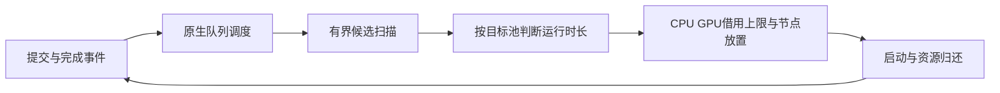

# HKUST MCM 2026 — Problem B

当前项目覆盖 **B 题三个问题**：工作负载分析、逐节点调度与放置、跨型号分流的情景实验。原始题面与数据保持不变。

## 最终提交物

- 论文：[reports/paper/paper.pdf](reports/paper/paper.pdf)（源文件 [paper.tex](reports/paper/paper.tex)）
- 代码补充包：运行 `python src/build_code_zip.py` 生成 `submission/code_supplement.zip`；包内英文说明见 [SUPPLEMENT_README.md](reports/paper/SUPPLEMENT_README.md)
- 论文图：`python src/plot_paper_figures.py` → `outputs/paper_figures/`

## 2026-10-20重新开放的v4实验

用户按D028重新开放实验：13个分流配置×3个开发资格种子，固定候选后以10个新种子验证两历史推荐与新候选，另做2个速度压力情景及已有调度的A10内部受损诊断。调度核心与Q2*=T7d不变，历史输出全部保留。

当前新增结果见[中文v4报告](reports/B_v4_validation_zh.md)、[英文v4报告](reports/B_v4_validation_en.md)、[验证汇总](outputs/v4_validation/validation_summary.csv)及[独立核验](outputs/v4_validation/verification.json)。新资格集合验证仍使用同一条工作负载，不能称跨trace泛化验证；论文统稿须保留这一限制。旧主稿 `reports/paper_draft_en.md` 尚未自动吸收v4结果。

```powershell
.\.venv\Scripts\python.exe src\run_v4_validation.py --phase all --workers 2
.\.venv\Scripts\python.exe src\analyze_v4_harm.py
.\.venv\Scripts\python.exe tests\verify_v4_outputs.py --audit-schedules
.\.venv\Scripts\python.exe src\report_v4_validation.py
```

原v4 runner受协议中的三小时预算约束；已有结果可按哈希复用。未来或从精简补充包复现三个锁定验证安排，用 `python src/reproduce_v4_full.py`，它在独立新目录重建Q2*与三个首验证种子完整安排，核对冻结基线哈希和关键数值；随后按输出的case路径运行 `tests/verify_schedules.py --scenario-dir <路径>`。原完整目录的v4综合核验还依赖全部历史输出和v3完整CSV，不应直接用于精简包。

## 阅读顺序

1. `CURRENT_STATUS.md`：交付内容、已验证结果和下一步。
2. `reports/B_Q1_analysis_zh.md`：中文完整解释、图表与指标口径。
3. `reports/B_Q1_report_en.md`：英文论文第 1 问草稿。
4. `DECISIONS.md`：时间窗口、统计口径等决策依据。
5. `reports/B_Q23_analysis_zh.md`：后两问的实验结果、取舍与建议。
6. `reports/B_Q23_report_en.md`：后两问英文论文草稿。
7. `reports/B_Q23_methods_zh.md`：后两问详细模型、事件顺序及预约证明。

## 复现

本次使用 Python 3.12，依赖见 `requirements.txt`。项目内 `.venv` 已准备好，可在仓库根目录运行：

```powershell
.\.venv\Scripts\python.exe src\analyze_question1.py
.\.venv\Scripts\python.exe -m unittest discover -s tests -v
.\.venv\Scripts\python.exe tests\verify_question1_outputs.py
```

在其他电脑的标准 Python 环境中，可以先创建虚拟环境并安装依赖：

```powershell
python -m venv .venv
.\.venv\Scripts\python.exe -m pip install -r requirements.txt
```

仅需重建数值表时可加 `--skip-figures`；正式更新交付结果时运行完整命令，使图表与数据一致。`--data-dir` 可指定输入目录，`--output-dir` 可指定输出目录。独立核验脚本检查默认比赛数据和默认输出路径。

## 第 2、3 问复现

最后一轮 **v3 实验**遵循D026：冻结Q2*与调度核心，计算分流交换比、积分补偿和命名型号双推荐。仅原v2主网格与12个v3主配置参与选择，敏感性与Q2曲线补点不重新选型。

```powershell
.\.venv\Scripts\python.exe src\run_v3_experiments.py --suite all
.\.venv\Scripts\python.exe -m unittest discover -s tests -p 'test_*.py'
.\.venv\Scripts\python.exe src\plot_v3_results.py
.\.venv\Scripts\python.exe src\write_v3_analysis.py
.\.venv\Scripts\python.exe tests\verify_v3_outputs.py
```

本轮默认时间盒至2026-10-17 16:03北京时间；未来主动复现冻结网格时加 `--reproduction`。从不含完整调度的补充包复现时，先把原始两CSV放回原数据目录，然后运行 `src\run_v3_experiments.py --suite all --bootstrap-dependencies --reproduction`；脚本只重建缺失的FCFS/SJF/Q2*基线CSV，不需要调用已过旧时限的runner。提交包保留各场景清单和小指标，详见 `SUBMISSION_PACKAGE.md`。

输出为 `outputs/question3/v3/`；`comparison.csv` 与 `compensation.csv`含每配置总账，`selection.json`保存两种推荐和固定阈值。旧v2配置的新指标位于其下 `v2_reference/`，历史输出保持原样。逐场景 `native_harm_by_donor.csv` 和 `borrowing_peaks.csv`分别记录个体代价和实际借用峰值。交换比分母为零时CSV数值留空，`exchange_ratio_infinite=True`；C/S在S≤0时为空并标记未定义。Q2的 `c2_multiplier_sensitivity.csv`仅用原22候选，`v3_curve_points/`的3个补点只用于图形展示。

历史 **v2 实验**（分组保护、对数aging、原生代价控制；以下为历史记录，应在独立副本运行，`write_v2_analysis.py`会改写当前中文稿）：

```powershell
.\.venv\Scripts\python.exe src\run_v2_experiments.py --suite all
.\.venv\Scripts\python.exe -m unittest discover -s tests -p 'test_*.py'
.\.venv\Scripts\python.exe tests\verify_v2_regression.py
.\.venv\Scripts\python.exe tests\verify_all_schedules.py
.\.venv\Scripts\python.exe src\plot_v2_results.py
.\.venv\Scripts\python.exe src\write_v2_analysis.py
.\.venv\Scripts\python.exe tests\verify_v2_outputs.py
```

可用 `--suite q2` / `--suite q3` 分段运行；Q3需要已生成的 `selection_v2.json` 和Q2*。v2主规则先登记于D023/D024，全部22个Q2候选保存正式FCFS配对尾部/减速比；Q3含11个主网格配置、6个固定推荐配置的单因素敏感性及1个SJF桥接。主网格和敏感性使用Q2*无分流基线，桥接仅对SJF。新扫描始终只存指标，完整新CSV仅用于Q2*、AH/AHS无控制对照、命名主推荐和匿名条件推荐（去重）。

新目录：`outputs/question2/v2_candidates/`、`log_aging_sweep/`、`q2_star/`、`outputs/question3/v2/`。选择清单为 `outputs/question2/selection_v2.json` 和 `outputs/question3/v2/selection.json`；候选对照为 `outputs/question2/comparison_v2.csv` 与 `outputs/question3/v2/comparison.csv`。正式尾部数据在各候选的 `tail_metrics.json`、`tail_by_duration_group.csv`、`tail_cohorts.csv`、`tail_model_distribution.csv`。超长迁入过滤不改变兼容标志；`a10_duration_eligible_jobs` 是兼容且满足时长界的作业数，不等于实际迁移数。

v2前源码快照保存在 `outputs/v2_reference/source/`。v2回归按原CSV检查19个历史完整场景，并用旧核心重放检查12个线性aging和15个上一轮Q3配置；精确比较全部调度字段及节点worker分配。历史场景输出不重写，审计汇总区分保留历史证据与当前新审计。历史manifest的源码哈希应匹配对应快照，不能将它们当作新版本源码哈希。

当前报告及10页统稿提纲：[中文分析](reports/B_Q23_analysis_zh.md)、[英文草稿](reports/B_Q23_report_en.md)、[论文提纲](reports/paper_outline.md)。新4组图单独保存在 `outputs/question2/figures_v2/` 和 `outputs/question3/v2/figures/`，保留旧图。

以下为 **v1 历史改进实验**（默认按当时源码记录），供了解旧工作流。当前不要用这些命令替代v2回归；新源码下重跑旧runner会重建历史场景，旧交付检查中的源码哈希也不应与当前版本直接比较：

```powershell
.\.venv\Scripts\python.exe src\run_scheduling_experiments.py --suite optimization --save-schedules key
.\.venv\Scripts\python.exe tests\verify_legacy_regression.py
.\.venv\Scripts\python.exe tests\verify_optimization_outputs.py
.\.venv\Scripts\python.exe -m unittest discover -s tests -p 'test_*.py'
.\.venv\Scripts\python.exe tests\verify_all_schedules.py
.\.venv\Scripts\python.exe src\plot_optimization_results.py
```

新默认 suite 为 `optimization`；也可分别运行 `--suite aging` 和 `--suite routing`（后者需要 aging_selection）。选择规则先登记于 DECISIONS D018–D021。12 个 α 完整扫描后，以选定 aging 为基线运行 15 个分流配置；SJF 桥接单独使用 SJF 基线。`--save-schedules key` 保存 aging_best、四个主配置及被选中的额外配置，`all` 保存所有新仿真的完整调度，`none` 不新写大 CSV；已存在的完整结果始终保留。指标扫描的 `scenario.json` 明确标注 `metrics_only`，独立审计将其列为跳过，不能据此声称通过逐节点审计。

新增结果位于 `outputs/question2/aging_sweep/`、`outputs/question2/aging_best/`、`outputs/question3/improved/`，参数选择与邻点敏感性另存 JSON/CSV。`outputs/question2/legacy_diagnostics/` 是从旧调度计算的新指标；旧 13 份调度、manifest 与独立审计不重写。新旧核心的逐作业、逐节点精确回归见 `outputs/legacy_regression.json`。

以下是原始 13 场景的历史复现命令；会重建旧目录，不应用来执行当前优化或替代保留参考文件的回归检查：

```powershell
.\.venv\Scripts\python.exe src\run_scheduling_experiments.py --suite all
.\.venv\Scripts\python.exe tests\verify_all_schedules.py
.\.venv\Scripts\python.exe src\plot_scheduling_results.py
```

`--suite question2` 或 `--suite question3` 可分开运行，Q3 需要先存在对应的 Q2 基线；修改数据或模型后先重跑 Q2，或直接运行 `--suite all`。也可使用 `--scenarios fcfs sjf` 等指定场景；`--force` 强制重建。只有输入、代码和配置哈希一致时才复用已有结果。全量原始作业每个场景均调度至完成，没有在第 90 天截断模拟。读取已保存结果时作业 ID 始终按字符串处理，使单独运行与缓存复用保持一致。

第 2 问比较 FCFS、严格 SJF、保护队首回填（扫描 128 与 512 个候选）；第 3 问主敏感性采用 SJF，改变兼容比例、假设加速倍数、迁入双资源上限及资格种子，另有一个回填分流对照。共 13 个场景。回填分流与无分流回填配对，其余分流场景与无分流 SJF 配对。

每个场景目录包含 `schedule.csv`（每作业启动/完成/型号）、`allocations.csv`（每作业在各节点上的 worker 数）、`scenario.json`（参数/哈希/运行诊断）、`metrics.json`、分组指标，以及独立核验结果。Q3 另有按同一原始作业比较的 `paired_wait_changes.csv`。时间和 CPU 小数使用默认最短可往返的浮点文本输出，避免固定有效位数引入截断或冗余尾差。

独立核验只读原始输入和保存的安排，不导入调度实现。它逐节点重建半开区间事件，以 Decimal 检查任意时刻 CPU/GPU 容量、全部 worker 数、型号/时长、迁移资格和双资源借用上限。它证明输出满足这些约束，**不证明算法最优**。所有场景的总核验结果在 `outputs/scheduling_validation.json`。

## 调度与实验公共接口 D032

调度算法与工程流程现在有三个独立入口，历史实现及实验脚本保持可复现。

| 层次 | 入口 | 责任 |
|---|---|---|
| 场景与策略 | `src/simulation_contract.py` | `SimulationSpec`声明队列、分流和目标池时长限制，校验组合并调用已验证的调度后端 |
| 结果存储 | `src/experiment_store.py` | 输入与代码指纹、单写者锁、缓存完整性、失败现场保留和完成后的原子发布，不依赖调度代码 |
| 运行与复现 | `src/reproduce_case.py` | 读取历史场景，显式传入原数据与配对基线，执行仿真、指标比较和独立审计 |


新的公共接口不依赖旧实验入口中的工具函数，也不把`tests/`作为运行时Python模块导入。独立Decimal验证器仍单独运行，以保持与调度实现的独立性。新场景的参数只能通过`SimulationSpec`进入；已有D030/031算法结果继续成立，本次工程复现不增加独立科学样本。

复现单个已保存场景，默认生成完整安排、节点分配、指标、独立审计、复现比较和来源收据：

```powershell
.\.venv\Scripts\python.exe src\reproduce_case.py --scenario outputs/v5_architecture/cases/runtime75_h30_s20261030_v0.8/scenario.json
# 路径可显式覆盖，使用相同数据与基线内容时不依赖贡献者本地路径
.\.venv\Scripts\python.exe src\reproduce_case.py --scenario outputs/v5_architecture/cases/runtime75_h30_s20261031_v0.8/scenario.json --output outputs/my_reproduction --data-dir 2026_MCM_Senior_GPU_Scheduling/2026_MCM_Senior_GPU_Scheduling --baseline outputs/question2/q2_star/schedule.csv
```

默认输出在`outputs/common_runtime_reproduction/cases/<原场景目录名>/`。来源有完整CSV时逐字节比较；来源仅有指标时比较已有标量指标，并对新建完整安排另行审计。复现需要原始CSV、配对基线、场景清单及完整参考或指标参考；来源实现哈希不符会拒绝执行，不能把不匹配的实现当作原版本。

复用时检查参数、输入、代码、基线和全部文件哈希。失败/中断的结果留在`staging/`，重新执行同一命令会新建临时目录；已完成且核验通过的场景直接复用。每个场景的操作系统文件锁会随进程退出自动释放；并发写同一场景会明确失败。最终目录只在仿真、比较与独立审计全通过后一次性发布，未完成结果不会出现在`cases/`中。已发布结果损坏或来源改变时，请使用新输出目录，不覆盖旧证据。

算法侧仍保留原生队列优先、逐节点GPU/CPU可行性与分池运行时长门槛；本次公共层没有改变排队或分流语义。A10内部公平性、工作量预算与动态反馈仍需独立实验。项目尚保留冻结历史核心与实验后端两个实现，公共接口不等于整个事件内核已经统一重写。

工程验收：171项单元测试通过；三个既有场景分别重现66项原指标，其中两个场景的四份完整CSV逐字节一致，另一原仅指标场景补建完整安排并独立审计。三份共17,820,389项Decimal检查通过；三案例再次运行全命中缓存，54份结果文件不变。历史来源与发布收据的验收可通过下列命令重查：

```powershell
.\.venv\Scripts\python.exe tests\verify_architecture_runtime.py
```

## 分流架构扩展 D030

新入口 `src/experimental_scheduler.py` 为分流准入提供显式接口，`src/routing_admission.py` 只判断目标池预计运行时长是否合格。调用方通过 `admission=` 注入策略；不传策略时要求所有启动时间、完成时间、型号和节点分配与旧核心完全一致。`src/scheduler.py` 保持冻结。



准入条件为 `original_duration / speedup <= donor_limit_seconds`，仍同时保留原始75天上限。A100与H800可以采用不同门槛；被所有目标池拒绝的作业留在原池，并不占据分流候选前缀。策略只使用已经到达的作业信息和声明的速度假设，不能读取未来提交。原生队列优先、双资源上限和非抢占规则继续由事件引擎执行。准入条件不是未来原生作业零损失保证。

`src/run_v5_architecture.py` 使用显式 `ExperimentContext` 传递输入、基线和输出路径，避免修改导入模块全局路径。协议只登记一次，来源代码/数据/配置不符时拒绝复用；完整结果用文件哈希收据检查。中断的部分目录保留并拒绝覆盖，恢复时可指定新输出目录完整重跑。独立文件仍复用原有指标和Decimal验证器。

```powershell
.\.venv\Scripts\python.exe src\run_v5_architecture.py --phase all
.\.venv\Scripts\python.exe -m unittest discover -s tests -p 'test_*.py'
.\.venv\Scripts\python.exe tests\verify_v5_outputs.py
# 独立复现到新目录，重新登记一小时计算预算；不覆盖旧证据
.\.venv\Scripts\python.exe src\run_v5_architecture.py --output outputs/v5_architecture_reproduction --phase all
```

本轮固定比较旧D75、双池迁移后75天上限、A100为75天且H800为30天上限，使用三个新资格种子及两种速度，共18次消融。它没有自动选型流程。原始目录的一小时预算到期后，`--phase all` 不会重启回归；独立复现请使用尚不存在的新输出目录。新目录需要原数据、13份历史完整安排、Q2*和v4 D75首种子完整安排，不是仅凭精简补充包即可直接运行。

这是一次有意限定范围的架构扩展：历史事件循环另存实验版本，队列和放置仍复用冻结实现。两个入口之间的语义一致性通过15份完整回归检查，不能将其描述为整个调度器已经彻底解耦。更广泛的队列、资源池与事件内核重构需要另行回归验证。

## A10内部等待保护 D033

`source_protection.py`维护只接收已到达作业的Q2*影子队列和带到期时间的节点空位；`source_guard_engine.py`把源池启动与影子预约绑定。尚未提前启动的作业保留Q2*原启动机会，已经迁出或提前启动的影子占用允许安全回填。借用作业必须在每个节点的预约结束前完成。实现明确限定当前A10每节点1 GPU，仍检查CPU、小数/零请求及多worker同启。

保护针对相对Q2*的逐作业等待，不是保证每个作业优于旧分流方案，也不保证速度小于1的迁出作业完成时间不受损。执行时长须按已知声明值运行；实际超时会破坏空位到期保证。该机制不读取预计算基线启动时刻，基线文件仅用于事后评价。

固定开发、锁定选择与验证由以下入口复现，新实验目录有独立两小时预算：

```powershell
.\.venv\Scripts\python.exe src/run_v6_source_protection.py --output outputs/v6_source_protection_reproduction --phase all
.\.venv\Scripts\python.exe tests/verify_v6_outputs.py --output outputs/v6_source_protection_reproduction
```

单案例复现使用`src/reproduce_source_case.py --scenario <v6场景的scenario.json> --output <新的复现目录>`，显式恢复`source_protection`。旧`SimulationSpec`及`reproduce_case.py`保留冻结契约，不支持这个字段，不能用旧入口复现受保护场景。新适配器仍复用公共存储、精确CSV/指标比较与独立Decimal审计；完整核验通过后才发布结果。

在Python中显式启用已登记的保护配置（`jobs`、`nodes`按前文方法读取，ID保留字符串）：

```python
from scheduler import RoutingConfig
from routing_admission import RuntimeAdmission
from source_protection import SourceProtection
from source_guard_engine import run_simulation

schedule, allocations, diagnostics = run_simulation(
    jobs, nodes, policy="log_aging", log_aging_tau_seconds=7*86400,
    routing=RoutingConfig(mode="pull", donors=("A100-SXM4-80GB", "H800"),
        seed=20261033, flexible_fraction=.5, speedup=1.,
        donor_cap_fraction=.25, max_routed_duration_seconds=75*86400),
    admission=RuntimeAdmission((("A100-SXM4-80GB", 75*86400.), ("H800", 30*86400.))),
    source_protection=SourceProtection(loan_scan=512),
)
```

传入`source_protection=None`关闭保护，保持v5实验引擎的安排语义。A10控制以`source_control_rule`为准；诊断中的旧`backfill_rule`描述原FCFS回填，旧`placement_checks`计数也未覆盖新增影子与空位查找，不用于跨引擎复杂度比较。

协议、开发选择、验证结果及验收位于`outputs/v6_source_protection/`。输入包括原始两个CSV、Q2*、原13份参考和v5分池75/30天首开发种子的两种速度完整安排。新引擎关闭保护时须精确复现全部16份参考；历史代码与结果不覆盖。独立验收还会核对每个实际空位借用是否处在基线可回收区间内，metrics_only案例不计作完整资源审计。

本轮完成36次开发和40次验证，锁定loans512。十个未用资格种子、两速度的20次候选验证均实现相对Q2*的A10零正等待损失，同时通过donor门槛。等速/慢速总体平均等待从3.598098/6.834822升至10.495106/14.839447小时，平均最终完工延至247.106285天；慢速仍有18.6977%的A10作业更晚完成，均来自迁出组。因此它作为公平性优先可选模式保留，不能表述为无代价的整体升级。

187项单元测试、16份历史完整回归及四份新完整调度的独立审计均通过。详见[中文报告](reports/B_v6_source_protection_zh.md)、[英文报告](reports/B_v6_source_protection_en.md)和[验收结果](outputs/v6_source_protection/verification.json)。查看已有结果只需运行`python tests/verify_v6_outputs.py`；再次完整重放请使用新输出目录。实验源代码由协议哈希绑定，修改科学实现需另建协议，不覆盖本轮记录。

## 交付目录

| 路径 | 内容 |
|---|---|
| `src/analyze_question1.py` | 数据校验、描述统计、容量压力、事件积分与绘图 |
| `tests/test_question1.py` | 人工可计算的资源碎片、零CPU、小数CPU、事件边界和集中度测试 |
| `tests/verify_question1_outputs.py` | 独立标准库/Decimal复算，不调用主分析函数 |
| `outputs/question1/tables/` | 11张机器可读CSV表 |
| `outputs/question1/figures/` | 5组英文图表，每组PNG与SVG版本 |
| `outputs/question1/summary.json` | 主要数值结论 |
| `outputs/question1/validation.json` | 数据完整性与汇总守恒检查 |
| `outputs/question1/provenance.json` | 原始文件哈希、软件版本和指标定义 |
| `outputs/question1/independent_validation.json` | 独立核验结果 |
| `reports/` | 中文分析及英文草稿 |
| `src/scheduler.py` | 在线、非抢占、全部 worker 同时启动的调度核心 |
| `src/run_scheduling_experiments.py` / `src/run_optimization_experiments.py` | 原始 13 场景及新 aging/pull 网格、预登记选择与来源记录 |
| `src/run_v2_experiments.py` | v2候选、分组约束选择、命名donor优先及固定配置敏感性 |
| `src/analyze_tail.py` | 严格ID配对的FCFS受损集合、工作量占比、尾部构成和减速比 |
| `src/plot_v2_results.py` | v2四组英文PNG/SVG图 |
| `tests/verify_v2_regression.py` | 历史完整CSV与上一轮核心重放的精确兼容检查 |
| `src/plot_optimization_results.py` | 新增 4 组 aging、公平性及跨池不均衡 PNG/SVG 图 |
| `src/evaluate_scheduling.py` | 固定窗口和最终完成指标、原生作业配对代价 |
| `src/plot_scheduling_results.py` | 第 2、3 问的 6 组 PNG/SVG 图 |
| `outputs/question2/comparison.csv` | 4 个调度配置的核心指标 |
| `outputs/question3/comparison.csv` | 9 个分流配置的核心指标 |
| `tests/verify_schedules.py` | 独立核验单个完整场景 |
| `tests/verify_all_schedules.py` | 批量核验所有已保存场景 |

## 表格口径

- `model_summary.csv`：型号容量、请求工作量、作业特征、空池可行性、立即启动假设下的窗口诊断。
- `distribution_summary.csv`：每个变量的均值、标准差和分位数；变量名在 `metric` 列。这里 `std` 是 pandas 描述统计的样本标准差；日变化CV另按总体标准差计算。
- `duration_band.csv`、`gpu_size_band.csv`：时长及整作业GPU数量分组，时长区间左开右闭。
- `daily_submissions.csv`、`daily_by_model.csv`：按提交日归属整个作业的完整工作量，日编号从0开始。
- `weekly_submissions.csv`：每7天一组，最后一组只有6天，跨组比较使用日均值；这里不代表真实日历周。
- `offered_load_daily.csv`：每个作业假设提交即启动，按事件间隔积分得到的每日资源请求。它不施加容量和放置约束。
- `concentration.csv`：按完整GPU工作量降序，取 `ceil(比例 × 作业数)` 个作业；同时报告实际选中比例。
- `request_profiles.csv`：按型号、每worker GPU/CPU请求和worker数分组的作业配置频次。
- `node_configurations.csv`：原始节点配置与台数；不使用统一节点配置替代异质节点。

## 必须保留的解释边界

1. 每个作业的资源数为每worker请求乘worker数；CPU可以是小数或零。
2. 按提交日汇总的完整工作量不等于当天执行量。
3. 默认观察窗口为 `[0, 90×86400)`，包含最后提交时刻后的122秒。精确最后提交时刻和两种压力口径均保留。
4. 完整工作量/窗口容量、立即启动的窗口需求与实际调度利用率是不同指标。Q1 不包含调度等待；Q2/Q3 的等待和分配率来自明确假设下的模拟。
5. 第0天及时间零的集中记录完整保留；不推断其未提供的来源或日历周期。
6. 图5展示日平均需求，可能掩盖短时峰值；瞬时峰值和超容量时间比例在型号汇总表中。
7. 长作业与高工作量作业保留，不任意删除或截断。
8. Q2/Q3 的分配率来自模拟中实际安排的资源积分，仍不等于硬件实测利用率。最终完成指标包含所有提交的作业，90 天指标单独计算。
9. Q3 的兼容率和速度均为声明的假设；保持 worker/GPU/CPU 数量，以 `duration/speedup` 换算时间。不得从这些假设推断真实硬件速度或显存兼容性。
10. 目标池原生作业优先及双资源借用上限不能保证其零损失。原版 arrival 只尝试新到达 A10；新版 pull 在事件时持续扫描等待资格作业，设最小等待时有独立资格事件。按原始 job_name 配对报告受损者；边际 P95 差与逐作业正延迟 P95 分别列示。
11. SJF 的平均等待优势不等于对所有作业或所有公平性指标都最好。完整论文需说明主要目标及最长等待、长作业尾部和最后完工时间的代价。
12. 新增滞留积分固定 donor 集合为 A100/A800/H800/GPU-series-2，是当前调度时间线上忽略兼容、CPU 和装箱的潜力诊断，不能直接解释为可兑现收益。匿名型号兼容性是假设，另列仅已命名型号的建议。
13. v2的C1保护时长组均值，不保证个体不受损。对数aging的T控制时长比与提交间隔的权衡；已同时在队列中的作业不会仅因时钟流逝交换优先级。所有参数仍在同一trace上选择。
14. donor预留GPU/CPU只在迁入启动后检查，后来原生作业可使用余量；v1–v4时长上限按原始时长过滤，速度敏感性不改变这个资格集合。v5另加按目标池迁移后时长的准入限制。这些机制仍不保证未来原生作业零损失。

`AGENTS.md` 约定后续协作方式。原始数据属于比赛资料；论文需遵守题面引用、AI披露和提交要求。
