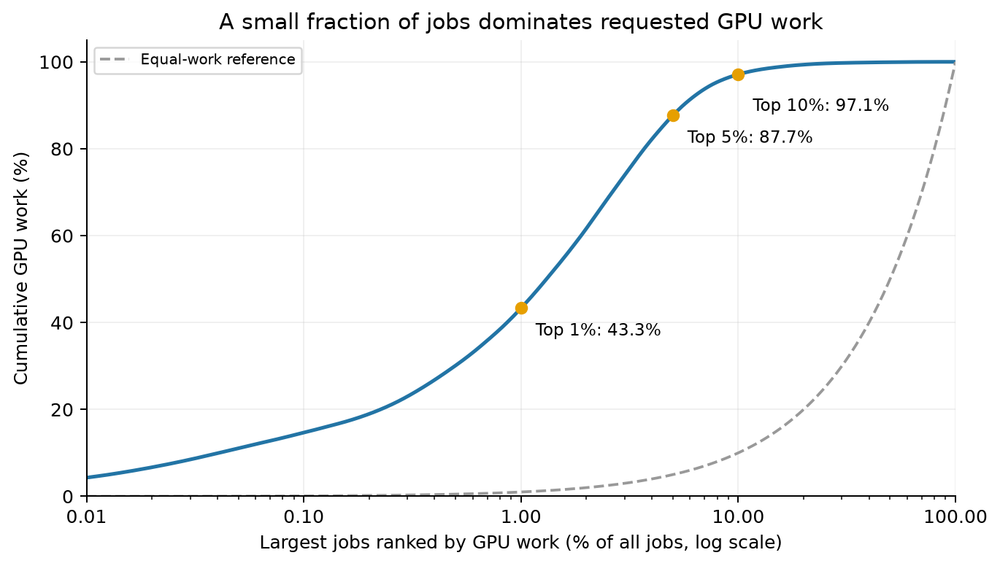

# B 题第 1 问：GPU 集群数据分析

更新日期：2026-10-17。范围：Senior Group Problem B, Question 1（Understand the Data）。本报告给出数据事实、需求诊断与后续建模依据；第 2 问调度器和第 3 问改进实验尚未完成。

## 1. 核心结论

数据的主要矛盾是**长时作业主导工作量、GPU 型号之间供需不均，以及到达时序与节点资源约束共同影响可调度性**。

- 全部数据包含 **224,112 个作业、4,278 台节点、6 类 GPU、10,412 张 GPU 和 632,636 vCPU**。完整请求工作量为 **24,605,876.43 GPU-hours** 和 **646,986,320.49 vCPU-hours**。
- **73.94%** 的作业只请求 1 张 GPU，这些作业仍贡献 **66.63%** 的 GPU 工作量；“大工作量”不能直接解释成“同时请求很多 GPU”。
- 时长超过 7 天的作业仅占 **6.00%**，却贡献 **76.95%** 的 GPU 工作量。按完整 GPU 工作量排序，前 1% 和前 5% 的作业分别贡献 **43.31%** 和 **87.68%**。
- A10 只有 **23.95%** 的 GPU 数量，却承接 **45.19%** 的 GPU 工作量；其完整工作量相当于该型号 **90 天理论供给的 2.064 倍**。在“到达即启动”的假设下，A10 的窗口内平均请求/容量为 **1.449**，且 **99.56%** 的窗口时间超过 GPU 容量。这支持将 A10 列为优先研究的拥堵资源池。
- 第 0 天及时间零点有明显集中记录。应完整保留并单独说明，不能据此认定真实周期性提交行为或已知的历史积压。
- 即使假设全部作业立即启动，仍有 **26.56%** 的 GPU 工作量位于 90 天窗口之后。因此，提交窗口不能作为全部作业必须完成的期限。

证据：[总体汇总](../outputs/question1/summary.json)、[型号汇总](../outputs/question1/tables/model_summary.csv)、[规模分组](../outputs/question1/tables/gpu_size_band.csv)、[时长分组](../outputs/question1/tables/duration_band.csv)、[集中度](../outputs/question1/tables/concentration.csv)。

## 2. 数据来源、口径与质量检查

### 2.1 输入与时间窗口

原始资料如下，分析过程未修改其内容：

- [B 题题面](../2026_MCM_Senior_GPU_Scheduling/2026_MCM_Senior_GPU_Scheduling/2026_MCM_GPU_Scheduling.pdf)
- [作业数据 job_info_clean.csv](../2026_MCM_Senior_GPU_Scheduling/2026_MCM_Senior_GPU_Scheduling/job_info_clean.csv)
- [节点数据 node_info_df.csv](../2026_MCM_Senior_GPU_Scheduling/2026_MCM_Senior_GPU_Scheduling/node_info_df.csv)

`submit_time` 和 `duration` 的单位为秒。首个提交时间为 0，最后一个为 **7,775,878 秒**。按完整日分箱，分析窗口设为

\[
[0,T),\qquad T=90\times86400=7,776,000\ \mathrm{s}.
\]

第 0 至第 89 天分别是相对于记录起点的 24 小时区间，不对应已知日历日期。完整日窗口比最后提交时间长 122 秒。周汇总以连续 7 天分组，最后一组只有 6 天，比较时采用日均值。

### 2.2 工作量定义

对作业 \(j\)，记每个 worker 请求的 GPU、CPU 为 \(g_j,c_j\)，worker 数为 \(m_j\)，运行时长为 \(d_j\)，提交时间为 \(s_j\)。整个作业的资源需求为

\[
G_j=g_jm_j,\qquad C_j=c_jm_j,
\]

完整请求工作量为

\[
W_j^G=\frac{G_jd_j}{3600}\quad\text{GPU-hours},\qquad
W_j^C=\frac{C_jd_j}{3600}\quad\text{vCPU-hours}.
\]

这两个量衡量资源被请求的数量与时长，不能直接等同 GPU 算力、有效计算量或实测使用率；不同型号的 GPU-hours 也没有做性能归一化。跨型号总量适合描述物理资源占用需求，不能据此推断跨型号运行速度。

### 2.3 校验结果

两张表均无缺失单元格、重复标识符、重复整行、非有限数值或非法数值域；作业型号均能匹配节点型号，提交时间已排序。保留 **1 个 CPU 请求为零**的作业与 **73 个 CPU 请求为小数**的作业。CPU 不能取整，零请求不构成错误。

对每个作业，检验匹配型号的空集群能否同时容纳全部 worker。设节点 \(n\) 的容量为 \(G_n,C_n\)，其可容纳的 worker 数为

\[
q_{jn}=\min\left(\left\lfloor G_n/g_j\right\rfloor,
\left\lfloor C_n/c_j\right\rfloor\right),
\]

其中 \(c_j=0\) 时忽略 CPU 限制；要求 \(\sum_n q_{jn}\ge m_j\)。**全部作业通过空集群可行性检查。** 这仅说明单个作业具有合法放置方式，不保证多个作业同时可行，也不保证到达时能立即启动。

型号、日期、周、时长组和规模组的工作量加总相互一致；事件积分与完整工作量核对一致。详见 [validation.json](../outputs/question1/validation.json)。

## 3. 作业类型、规模与时长

数据没有应用类型标签，因此不能将记录直接标为“训练”“推理”或特定业务。本问采用可以从字段验证的分类：GPU 型号、worker 数、整个作业 GPU 数和时长区间。

**小规模作业数量多，但资源需求跨越很大范围。** 单 worker 作业占 **90.95%**；整个作业 GPU 数的中位数为 **1**，P95 为 **13**，P99 为 **56**，最大值为 **1,456**。多 worker 作业占 **9.05%**，贡献 **19.81%** 的 GPU 工作量，说明整体启动和跨节点放置是必要约束。H800 的多 worker 作业比例为 **61.90%**，作业 GPU 数中位数为 **16**，与以单 GPU 请求为主的 A10 结构不同。

| 整个作业 GPU 数 | 作业数 | 作业占比 | GPU 工作量占比 |
|---|---:|---:|---:|
| 1 | 165,715 | 73.94% | 66.63% |
| 2–4 | 26,218 | 11.70% | 6.06% |
| 5–8 | 19,927 | 8.89% | 7.97% |
| 9–32 | 9,208 | 4.11% | 5.73% |
| 大于 32 | 3,044 | 1.36% | 13.60% |

**时长分布明显右偏。** 中位数只有 **22.17 分钟**，均值却为 **3.21 天**；P95 为 **12.88 天**，P99 约 **94.00 天**，最大值约 **184.00 天**。时长不超过 1 小时的作业占 **70.75%**，但仅贡献约 **0.72%** 的 GPU 工作量；超过 7 天的作业贡献 **76.95%**。


图 1：分别按运行时长和整个作业 GPU 数绘制累计作业占比与累计 GPU 工作量占比。两条曲线的差异显示“多数作业”的特征与“多数工作量”的特征不同。

证据：[分布统计](../outputs/question1/tables/distribution_summary.csv)、[时长分组](../outputs/question1/tables/duration_band.csv)、[规模分组](../outputs/question1/tables/gpu_size_band.csv)、[请求组合](../outputs/question1/tables/request_profiles.csv)。分位数采用线性插值；图中对数坐标只用于展示，未删除或压缩尾部记录。

## 4. 少数作业主导 GPU 工作量

以 \(W_j^G\) 降序排列，取前 \(\lceil pN\rceil\) 个作业，定义累计工作量占比

\[
S(p)=\frac{\sum_{j=1}^{\lceil pN\rceil}W_{(j)}^G}{\sum_{j=1}^{N}W_j^G}.
\]

| 排名前列的作业比例 | 选中作业数 | GPU 工作量占比 |
|---|---:|---:|
| 前 0.1% | 225 | 14.68% |
| 前 1% | 2,242 | 43.31% |
| 前 5% | 11,206 | 87.68% |
| 前 10% | 22,412 | 97.11% |

工作量 Gini 系数为 **0.9522**。这里它只表示请求工作量分布的不均匀程度，不能作为调度公平性的实测结果。



图 2：按 GPU 工作量从大到小排序的累计占比；横轴使用对数刻度。头部作业保留完整，没有按异常值裁剪。

结合上一节，集中度主要提醒我们关注“规模 × 时长”，不能只盯住同时请求大量 GPU 的作业。后续需要分别评估短作业等待与长作业等待，避免只优化平均等待就忽视持续占用资源的作业群体；此处尚未验证任何调度策略的收益。

## 5. 型号需求、容量与 CPU/GPU 配比

### 5.1 完整工作量与 90 天理论供给

对型号 \(k\)，定义

\[
\rho_k^G=\frac{\sum_{j:k(j)=k}W_j^G}{24T_d\sum_{n:k(n)=k}G_n},\qquad
\rho_k^C=\frac{\sum_{j:k(j)=k}W_j^C}{24T_d\sum_{n:k(n)=k}C_n},\quad T_d=90.
\]

分子包括窗口内提交的作业的**全部时长**；分母是 **90 天**内物理容量的理论供给。因此 \(\rho\) 是工作量与容量时间之比，不是 90 天实测利用率，也不是严格的窗口内需求积分。

| 型号 | 节点数 | GPU 数 | 作业数 | GPU 工作量（百万 GPU-hours） | \(\rho_k^G\) | \(\rho_k^C\) |
|---|---:|---:|---:|---:|---:|---:|
| A10 | 2,494 | 2,494 | 111,284 | 11.119 | 2.064 | 0.391 |
| A100-SXM4-80GB | 432 | 3,456 | 80,877 | 5.936 | 0.795 | 0.534 |
| A800-SXM4-80GB | 22 | 176 | 3,959 | 0.232 | 0.611 | 0.526 |
| GPU-series-1 | 989 | 1,558 | 9,643 | 3.892 | 1.156 | 0.590 |
| GPU-series-2 | 122 | 976 | 13,633 | 1.224 | 0.580 | 0.382 |
| H800 | 219 | 1,752 | 4,716 | 2.203 | 0.582 | 0.540 |

A10 的工作量压力最大。A100 的 GPU 数占 **33.19%**，工作量占 **24.12%**；H800 对应为 **16.83%** 与 **8.95%**。这表明各型号的请求与物理资源分布不一致，但不能直接宣布将 A10 作业迁至这些型号就一定可行：兼容性、运行时长变化和目标池的本地作业仍须另行建模。

GPU-series-1 的 \(\rho^G=1.156>1\) 需要特别谨慎解释。它说明全部提交作业需要超过 90 天的 GPU 容量时间；由于大量运行时间位于窗口之后，不能仅凭此数值断言它在窗口内总量超载。


图 3：作业数、完整 GPU 工作量和 GPU 数量的占比，以及完整 GPU/CPU 工作量与 90 天理论供给的比值。数值不是实测利用率。

### 5.2 CPU/GPU 配比与节点粒度

比较工作量加权的 CPU/GPU 请求比例 \(\sum W_j^C/\sum W_j^G\) 与物理容量比例 \(\sum C_n/\sum G_n\)：

| 型号 | 请求工作量比例（vCPU-hours/GPU-hour） | 容量比例（vCPU/GPU） |
|---|---:|---:|
| A10 | 24.24 | 128.00 |
| A100-SXM4-80GB | 10.75 | 16.00 |
| A800-SXM4-80GB | 13.78 | 16.00 |
| GPU-series-1 | 62.20 | 121.84 |
| GPU-series-2 | 15.79 | 24.00 |
| H800 | 22.27 | 24.00 |

A10 的请求相对更偏向 GPU，H800 的 CPU/GPU 请求比例则更接近节点配置比例。但汇总比例无法证明 CPU 永远富余：同一个 worker 的 CPU 与 GPU 必须放在同一节点，局部碎片和特定请求组合可能造成阻塞。

节点配置也不同：A10 节点每台 1 张 GPU；A100、A800、GPU-series-2、H800 节点每台 8 张；GPU-series-1 包含 1、4、8 张 GPU 的节点。调度器因此需要同时维护节点级 CPU 与 GPU 余量，不能只维护每种型号的 GPU 总数。详见 [节点配置](../outputs/question1/tables/node_configurations.csv) 和 [型号汇总](../outputs/question1/tables/model_summary.csv)。

## 6. 时间变化与窗口外工作量

### 6.1 按提交日归属完整工作量

对第 \(b\) 天，分别统计作业数 \(N_b\) 和该天提交作业的完整工作量

\[
D_b^G=\sum_{j:\lfloor s_j/86400\rfloor=b}W_j^G.
\]

\(D_b^G\) 不是当天执行的 GPU-hours。一个当天提交、运行 100 天的作业，其全部请求工作量都归入当天。

第 0 天同时是提交数量和提交工作量峰值：**8,509 个作业、6,095,923.98 GPU-hours**，占全体 GPU 工作量 **24.77%**。其中恰在 \(s_j=0\) 的 **3,512 个作业**贡献全体 GPU 工作量 **23.07%**。这些记录的集中性可能与数据构造、时间对齐或截取方式有关；提供的数据无法确定原因，也不能自行当成已知在运行作业而改变其语义。

以总体标准差计算 \(CV=\sigma/\mu\)（`ddof=0`），90 天作业数的 CV 为 **0.406**，提交 GPU 工作量的 CV 为 **2.283**。仅作诊断、排除第 0 天后，二者分别为 **0.326** 和 **0.453**。工作量序列的强烈波动很大程度受初始日影响，但排除初始日后仍有变化。主分析完整保留第 0 天；此对照不是删改数据。


图 4：每日提交数量与按提交日归属的完整 GPU 工作量，叠加 7 天移动平均。图中天数为相对记录起点的索引；移动平均用于展示变化，不构成周期或因果证据。

证据：[日汇总](../outputs/question1/tables/daily_submissions.csv)、[型号每日汇总](../outputs/question1/tables/daily_by_model.csv)、[周汇总](../outputs/question1/tables/weekly_submissions.csv)。本阶段不据此宣称真实星期效应、业务周期或可预测的季节性。

### 6.2 假设立即启动的窗口内请求

为了区分工作量尾部与窗口内同时需求，构造诊断量

\[
L_k^G(t)=\sum_{j:k(j)=k}G_j\,\mathbf 1\{s_j\le t<s_j+d_j\},
\qquad
\bar\ell_k^G=\frac{\int_0^T L_k^G(t)\,dt}{T\sum_{n:k(n)=k}G_n}.
\]

这里假设每个作业提交即启动，不施加容量、排队或节点放置约束。它是**无约束请求负载**，并非可行调度或实际利用率。CPU 量按相同方式定义。峰值和超过容量的时间比例由完整事件时间轴计算；图中显示日平均值，可能平滑掉短峰。

| 型号 | 窗口内平均 GPU 请求/容量 | 瞬时峰值/容量 | 超过 GPU 容量的窗口时间占比 |
|---|---:|---:|---:|
| A10 | 1.449 | 1.645 | 99.555% |
| A100-SXM4-80GB | 0.628 | 0.845 | 0% |
| A800-SXM4-80GB | 0.573 | 1.483 | 1.222% |
| GPU-series-1 | 0.609 | 0.953 | 0% |
| GPU-series-2 | 0.569 | 1.212 | 0.613% |
| H800 | 0.558 | 1.074 | 0.057% |

A10 的平均和峰值都超过容量；A800、GPU-series-2 和 H800 虽平均低于 1，仍有短时超量，说明平均工作量压力不能替代时序分析。GPU-series-1 的瞬时峰值也低于 1，因此不能称其窗口内总量持续超载；这仍不排除节点级放置阻塞。CPU 方面，A800 的窗口瞬时峰值/容量约 **1.245**，超过容量的时间占约 **0.556%**，进一步说明 CPU 约束不能省略。


图 5：假设全部作业到达即启动时，各型号日平均 GPU 请求/容量。虚线为容量阈值。该图不包含调度过程或测得的资源使用率。

### 6.3 运行时长与完工下界

**2,334 个作业的时长超过 90 天**。即使到达即启动，也有 **5,632 个作业**会在窗口结束后完成，且 **26.56%** 的完整 GPU 工作量发生在窗口之后。最后一个立即启动作业的假设完成时刻为记录起点后 **184.056 天**。

在容量恒定、不扩容、严格匹配 GPU 型号且不早于提交时间启动的条件下，全部作业的最后完成时间还必须满足

\[
C_{\max}\ge
\max\left\{
\max_j(s_j+d_j),
\max_k\frac{\sum_{j:k(j)=k}G_jd_j}{\sum_{n:k(n)=k}G_n},
\max_k\frac{\sum_{j:k(j)=k}C_jd_j}{\sum_{n:k(n)=k}C_n}
\right\}.
\]

换算为天，所得下界为 **185.762 天**，由 A10 完整 GPU 工作量除以其容量得到。该下界忽略了部分到达时序、资源碎片及不可抢占约束，不能当作已实现或一定可达到的完成时间。若第 3 问改变型号兼容性或容量，需重新推导适用下界。

## 7. 对后续建模的直接启示

| 已观察到的事实 | 后续应验证的设计或指标 |
|---|---|
| 大量短作业与少量长时高工作量作业并存 | 比较 FCFS、短作业优先和带队首预约的回填；分别报告短/长作业等待时间及尾部指标 |
| A10 的容量压力明显高于其他型号 | 先按型号报告性能；再对有兼容性假设的分流做情景实验，并检查目标池原有作业是否受损 |
| H800 等型号有较多 multiworker 作业 | 严格实现全部 worker 同时启动与节点放置；不能只检查总 GPU 是否够用 |
| 请求 CPU/GPU 比例和节点配置不同 | 双资源可行性检查；研究资源碎片，避免 GPU 可用但 CPU 不足的非法放置 |
| 平均需求偏低的型号仍有短时超量 | 采用事件驱动仿真，记录时间序列与高分位等待，不能只比较总体平均值 |
| 大量工作量延伸至提交窗口之后 | 同时报告固定 90 天窗口内表现与全部完成后的表现；明确未完成作业，避免完成样本选择偏差 |
| 初始时间记录集中 | 主结果完整保留；如做敏感性分析，须明确改变了哪些假设，不解释成已验证周期 |

以上均为**待运行的实验或实现要求**，没有在本问中声称等待时间下降、利用率提高或分流带来收益。

## 8. 复现、证据与人工核验

在项目根目录运行：

```powershell
python src/analyze_question1.py
```

依赖见 [requirements.txt](../requirements.txt)。源代码支持 `--data-dir`、`--output-dir` 和 `--skip-figures`；默认路径相对于仓库确定。派生表、PNG/SVG 图以及汇总文件写入 `outputs/question1/`。

- [分析脚本](../src/analyze_question1.py)
- [运行环境、单位、定义与哈希](../outputs/question1/provenance.json)
- [质量检查](../outputs/question1/validation.json)
- [独立 Decimal 核验：2,350 项比较通过](../outputs/question1/independent_validation.json)
- [汇总结果](../outputs/question1/summary.json)

输入 SHA-256：

```text
job_info_clean.csv
735bc06c3986b1d0c5932236f8685b7204463829118fc6a1d37030e253ed38e1
node_info_df.csv
1aba161961a5a4a1a61aa581383c5e5abe3400b59f8597ba8c4eef7597bc9d18
```

参赛前应由团队复核题面单位与约束、图表在论文中的可读性、全部数字与最新运行输出的一致性，以及“请求”与“实测使用”的措辞。本报告和分析代码有 AI 辅助，最终提交需按题面要求披露；项目记录见 [CURRENT_STATUS.md](../CURRENT_STATUS.md)。
