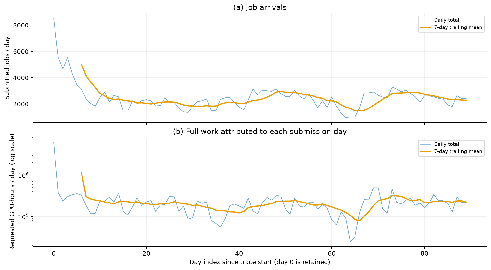
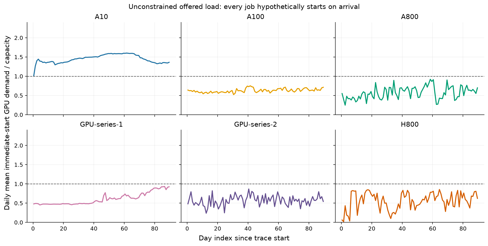

# Question 1 — Workload and Cluster Characterization

Draft for the competition report, 17 October 2026. This section describes the data and motivates later experiments; it reports no scheduling or migration results.

## Data and definitions

The supplied trace contains 224,112 jobs and 4,278 nodes, with 10,412 GPUs of six types and 632,636 vCPUs. Submission times range from 0 to 7,775,878 seconds. We use 90 complete daily bins, defining the observation window as \([0,T)\), where \(T=7,776,000\) seconds. Day indices are relative to the trace origin, not known calendar dates.

For job \(j\), let \(g_j,c_j\) denote per-worker GPU and CPU requests, \(m_j\) its worker count, \(d_j\) its duration in seconds, and \(s_j\) its submission time. Whole-job requests and lifetime work are

\[
G_j=g_jm_j,\quad C_j=c_jm_j,\qquad
W_j^G=G_jd_j/3600,\quad W_j^C=C_jd_j/3600.
\]

The totals are 24.606 million GPU-hours and 646.986 million vCPU-hours. These measure requested resource occupancy, not measured utilization or performance-normalized computation. No missing values, duplicate identifiers, unknown GPU types, or invalid numerical domains were found. All jobs fit their compatible empty pools under simultaneous worker placement. We retain 73 fractional CPU requests and one zero request. Extreme jobs are preserved.

## Job structure and concentration

Application labels are unavailable, so we classify jobs by resource shape and runtime rather than infer training or inference workloads. Single-worker jobs comprise 90.95% of submissions. Single-GPU jobs comprise 73.94% and account for 66.63% of GPU work. Whole-job GPU demand has median 1, 95th percentile 13, and maximum 1,456. H800 differs markedly: 61.90% of its jobs have multiple workers and its median whole-job demand is 16 GPUs.

Runtime is strongly right-skewed: the median is 22.17 minutes, the mean 3.21 days, the 95th percentile 12.88 days, and the maximum approximately 184 days. Jobs lasting at most one hour constitute 70.75% of submissions but only 0.72% of GPU work. Jobs exceeding seven days comprise 6.00% but contribute 76.95% of work. Thus, high-work jobs should not be equated with jobs requesting many simultaneous GPUs.

*Figure 1. Cumulative job and GPU-work shares by runtime and whole-job GPU demand.*

Sorting jobs by lifetime GPU work and selecting the largest \(\lceil pN\rceil\), the top 1%, 5%, and 10% contribute 43.31%, 87.68%, and 97.11%, respectively. The work Gini coefficient is 0.9522; this describes demand concentration, not scheduling fairness. These findings motivate evaluating both short-job responsiveness and long-job waiting, instead of reporting only an overall mean.

## Model-specific demand and resource balance

For GPU type \(k\), define the workload-to-capacity ratio

\[
\rho_k^G=\frac{\sum_{j:k(j)=k}W_j^G}{24(90)\sum_{n:k(n)=k}G_n},
\]

with an analogous CPU ratio. The numerator includes complete lifetimes of submitted jobs, including work beyond the observation window. Consequently, \(\rho_k\) is not utilization within that window.

| GPU type | GPUs | Jobs | GPU work / 90-day supply | CPU work / 90-day supply |
|---|---:|---:|---:|---:|
| A10 | 2,494 | 111,284 | 2.064 | 0.391 |
| A100-SXM4-80GB | 3,456 | 80,877 | 0.795 | 0.534 |
| A800-SXM4-80GB | 176 | 3,959 | 0.611 | 0.526 |
| GPU-series-1 | 1,558 | 9,643 | 1.156 | 0.590 |
| GPU-series-2 | 976 | 13,633 | 0.580 | 0.382 |
| H800 | 1,752 | 4,716 | 0.582 | 0.540 |

A10 carries 45.19% of GPU work with 23.95% of GPUs. Its requested CPU/GPU work ratio is 24.24 vCPU-hours per GPU-hour, compared with 128.00 vCPUs per GPU in hardware. H800's corresponding ratios, 22.27 and 24.00, are much closer. Such aggregate comparisons cannot rule out CPU bottlenecks or placement fragmentation: each worker requires colocated CPU and GPU resources. A10 nodes each contain one GPU, whereas GPU-series-1 mixes one-, four-, and eight-GPU nodes; node-level accounting is therefore essential.

*Figure 2. Demand composition and full-work-to-capacity ratios; neither panel measures utilization.*

## Temporal demand and horizon effects

Daily submitted work attributes each job's complete lifetime work to its arrival day. Day 0 peaks at 8,509 submissions and 6.096 million GPU-hours. Exactly 3,512 jobs arrive at time zero, accounting for 23.07% of total work. Their origin is unknown; this concentration cannot establish natural periodicity or a known historical backlog.

Using population standard deviations, daily count and submitted-work coefficients of variation are 0.406 and 2.283. Excluding day 0 for diagnosis reduces these to 0.326 and 0.453; all observations remain in the main analysis.

*Figure 3. Daily submissions and lifetime work assigned to arrival days, with trailing seven-day means.*

To isolate concurrency, we additionally construct unconstrained immediate-start demand:

\[
L_k^G(t)=\sum_{j:k(j)=k}G_j\mathbf1\{s_j\le t<s_j+d_j\}.
\]

This diagnostic enforces neither capacity nor placement. A10's window-average demand/capacity ratio is 1.449, its instantaneous peak is 1.645, and it exceeds capacity for 99.56% of the window. A800, GPU-series-2, and H800 have averages below one but peaks above one. Conversely, GPU-series-1 peaks at only 0.953 despite its full-work ratio exceeding one. Its long workload tail must not be mistaken for observed within-window aggregate overload. A800 also briefly exceeds CPU capacity.

*Figure 4. Daily mean hypothetical immediate-start GPU demand; short instantaneous peaks may be smoothed.*

Even with immediate starts, 5,632 jobs finish after day 90 and 26.56% of GPU work lies beyond the window. Under fixed capacities and strict model matching, total A10 work alone implies a final-completion lower bound of 185.762 days from time zero. This is a lower bound, not an achieved schedule. Subsequent experiments should report both fixed-window outcomes and eventual completion, preserve long jobs, and evaluate model-specific congestion alongside waiting-time tails.

## Reproducibility and evidence

Run `python src/analyze_question1.py` from the repository root. Inputs: [jobs](../2026_MCM_Senior_GPU_Scheduling/2026_MCM_Senior_GPU_Scheduling/job_info_clean.csv) and [nodes](../2026_MCM_Senior_GPU_Scheduling/2026_MCM_Senior_GPU_Scheduling/node_info_df.csv). Evidence: [summary](../outputs/question1/summary.json), [model statistics](../outputs/question1/tables/model_summary.csv), [distributions](../outputs/question1/tables/distribution_summary.csv), [concentration](../outputs/question1/tables/concentration.csv), [daily submissions](../outputs/question1/tables/daily_submissions.csv), and [daily offered load](../outputs/question1/tables/offered_load_daily.csv). Input hashes, software versions, units, and exact definitions are recorded in [provenance](../outputs/question1/provenance.json). Both [data validation](../outputs/question1/validation.json) and [2,350 independent Decimal comparisons](../outputs/question1/independent_validation.json) passed. Figure selection and compression remain subject to the full report's ten-page limit.
