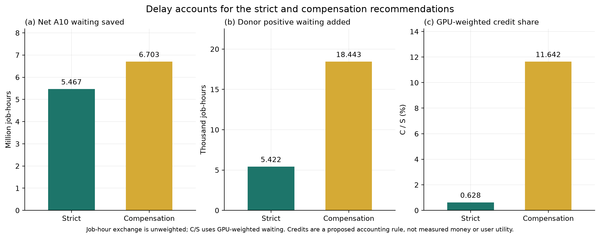

# B题第2、3问：最终分流权衡与补偿方案

更新日期：2026-10-17。最后一轮按 `TASK_v3_routing_frontier.md` 和运行前登记的[D026](../DECISIONS.md)执行；Q2*与调度核心保持不变，实验完成后冻结。[英文稿](B_Q23_report_en.md)、[10页提纲](paper_outline.md)、[方法第12节](B_Q23_methods_zh.md)和[提交包说明](../SUBMISSION_PACKAGE.md)供统稿使用。

## 1. 最终结论

Q2*仍为对数aging T=7天：总体平均等待31.190小时、最大1514.551小时。相对SJF最大等待下降49.80%，但P99等待从366.313升至1097.589小时，不能写成全面改善。

**严格推荐：`v3_ah_d60`**，A100-SXM4-80GB → H800；原时长≤60天；τ=0小时；cap=0.25。总体平均等待降至6.818小时，较Q2*减少78.14%；所有donor分别满足原生均值增量≤0.5小时、边际P95增量≤2小时。

**需管理层采用补偿机制的推荐：`v2_ah`**，A100-SXM4-80GB → H800；不限时长；τ=0小时；cap=0.25。总体平均等待1.361小时，交换比363.46，逐donor均值增量≤1小时且受损比例≤20%；积分补偿比C/S=11.642%。两种推荐不同，应按管理目标分别呈现。两者均只用命名型号，匿名兼容不是建议的前提。

## 2. A10饱和与SJF的真实代价

全部224,112个作业保留，每个worker的GPU/CPU在同一节点上，全部worker同时启动、不可抢占。各方案初始空闲、只使用已到达作业。90天用于固定窗口评价，仿真仍运行至所有作业完成。A10在既有策略下GPU分配率约99.9%，本池排序不能增加物理容量；它仍能改变哪些作业先完成、固定窗口完成数和等待分布，因此不能声称吞吐指标在所有策略下相同。

SJF在**所有四个原始时长组**的平均等待均低于FCFS，包括>7天组：

| 原始时长组 | FCFS均值/h | SJF均值/h | Q2*均值/h |
| --- | --- | --- | --- |
| <=1h | 502.810 | 0.033 | 0.033 |
| 1h-1d | 272.901 | 0.282 | 5.679 |
| 1d-7d | 250.781 | 8.321 | 117.769 |
| >7d | 480.924 | 270.187 | 435.819 |

正式FCFS配对分析如下；受损定义为等待严格增加，工作量按原时长×每worker GPU×worker数加权。

| 策略 | 受损作业数 | 受损比例 | 受损者平均增量/h | 受损者GPU工作量占比 | 等待>1000h | 等待>FCFS最大值 |
| --- | --- | --- | --- | --- | --- | --- |
| sjf | 2502 | 1.1164% | 770.493 | 14.832% | 1525 | 1199 |
| tau_604800 | 3012 | 1.3440% | 118.594 | 19.183% | 3354 | 159 |

SJF的2,502个受损者并非全是A10：2,031个A10、392个series-1、53个series-2、26个A800。**等待>1000小时的1,525个作业则全部来自A10**，原始时长从49.521到183.508天；等待超过FCFS精确最大值1,423.2563889小时的1,199个作业也均为A10。尾部作业数虽少，受损集合占总GPU工作量14.832%，不能忽略。

Q2*将超过FCFS最大等待的作业从1,199减至159，并大幅降低受损者平均正增量；但受损人数、受损工作量占比及等待>1000小时人数均增加。这里是把最极端等待摊得更广的一种折中，不能从C1组均值约束推出个体公平性。

数据来源：[SJF尾部汇总](../outputs/question2/v2_candidates/sjf/tail_metrics.json)、[尾部时长分位数](../outputs/question2/v2_candidates/sjf/tail_cohorts.csv)、[型号构成](../outputs/question2/v2_candidates/sjf/tail_model_distribution.csv)、[Q2*尾部汇总](../outputs/question2/q2_star/tail_metrics.json)。

## 3. 对数aging与选择规则

线性aging使用`d+αa`。由于时长跨多个数量级，小α接近SJF，大α迅速偏向提交顺序。对数aging改用 `ln(d/1秒)+a/T`；提交间隔每增加T，可抵消e倍的时长差。长作业和后来短作业的临界提交间隔为 `T ln(d_long/d_short)`。所有已经同时等待的作业仍使用静态相对顺序，不存在单凭时钟流逝发生的队内交叉。

D023在新扫描前固定：C1要求四个时长组均值分别不高于FCFS；C2要求总体均值≤2×SJF，即精确阈值33.135290849小时。对可行候选先最小化最大等待，再最小化均值，再按名称排序。只对旧候选应用新规则，确实选出α=1；加入6个对数参数后选T=7天。共22个候选、11个可行点，逐项判定保存在[selection_v2.json](../outputs/question2/selection_v2.json)。

| 策略 | 均值/h | 最大等待/h | P99等待/h | P99有界减速比 | 最后完工/天 | C1/C2可行 |
| --- | --- | --- | --- | --- | --- | --- |
| fcfs | 447.319 | 1,423.256 | 1,416.306 | 77,923.734 | 243.264 | 否 |
| sjf | 16.568 | 3,017.288 | 366.313 | 4.179 | 309.720 | 是 |
| backfill | 446.156 | 1,422.327 | 1,414.718 | 77,667.189 | 243.229 | 否 |
| backfill_l512 | 443.018 | 1,422.166 | 1,413.367 | 77,177.454 | 243.220 | 否 |
| alpha_1 | 18.435 | 2,841.827 | 706.994 | 24.983 | 302.409 | 是 |
| alpha_100 | 432.865 | 1,421.416 | 1,393.817 | 76,516.467 | 243.226 | 否 |
| tau_3600 | 438.571 | 1,421.859 | 1,407.311 | 77,047.839 | 243.244 | 否 |
| tau_21600 | 402.101 | 1,424.928 | 1,365.898 | 72,858.564 | 243.372 | 否 |
| tau_86400 | 316.641 | 1,426.914 | 1,245.551 | 58,838.054 | 243.455 | 否 |
| tau_259200 | 145.044 | 1,443.017 | 1,176.289 | 17,317.468 | 244.126 | 否 |
| tau_604800 | 31.190 | 1,514.551 | 1,097.589 | 7.883 | 247.106 | 是 |
| tau_2592000 | 19.833 | 2,187.630 | 884.002 | 4.116 | 275.151 | 是 |

有界减速比为 `max(1,(end−submit)/max(run_duration,60秒))`，无量纲。最大等待由单个极值决定，P99较少受单点影响，因此两者必须并列。T=7天的最大等待优于SJF而P99变差，这正说明单指标不能描述全部尾部。全部候选和分组减速比另存机器可读表。

上一轮α=100仍可作为必须同时封顶最大等待和清空时间时的备选；它的均值432.865小时只比FCFS改善3.23%，不再作为当前Q3主基线。修改选择规则是根据上一轮分析重新定义管理目标，不是独立样本外验证，也不意味着FCFS具有一般的最大等待最优性。

### 3.1 最终轮补充

仅对原22个候选将C2改为1.5、2、3倍SJF均值，依次选择tau_2592000, tau_604800, tau_604800，符合预期核对。新增T=10/14/21天点只用于画曲线，不纳入重选；Q2*=7天保持冻结。[倍数敏感性](../outputs/question2/c2_multiplier_sensitivity.csv)、[曲线补点](../outputs/question2/v3_curve_points/comparison.csv)。

## 4. Q3双推荐：约束与完整权衡

主实验均与同一Q2*无分流配对，默认p=.5、速度1、种子20261017。候选为11个v2主配置和12个v3主配置；严格与补偿分别最大化A10净平均等待下降，平局按配置名。敏感性不参与选择。补偿门槛为交换比≥100、每个donor均值增量≤1小时、每个donor受损比例≤20%；三个门槛及积分机制均是管理假设，运行后没有追改。

| 方案 | 配置 | 总体均值/h | 最大等待/h | 最后完工/天 | 最大donor均值增量/h | 最大donor P95增量/h | 最大donor受损比例 |
| --- | --- | --- | --- | --- | --- | --- | --- |
| 严格推荐 | v3_ah_d60 | 6.818 | 788.598 | 216.858 | 0.067 | 0.000 | 4.59% |
| 补偿推荐 | v2_ah | 1.361 | 494.451 | 204.602 | 0.857 | 5.836 | 17.41% |
| v2七天基准 | v2_ah_d7 | 26.368 | 1,445.110 | 244.213 | 0.000 | 0.000 | 0.00% |

新增12个配置的完整结果如下；严格、补偿可行性是各自多项条件共同判定，不能只看图中一条均值阈值线。

| 配置 | A10均值下降/h | 总体均值/h | 最大donor均值增量/h | 最大donor P95增量/h | 最大donor受损比例 | 严格可行 | 补偿可行 |
| --- | --- | --- | --- | --- | --- | --- | --- |
| v3_ah_d14 | 16.649 | 22.922 | 0.000 | 0.000 | 0.00% | 是 | 是 |
| v3_ah_d30 | 30.987 | 15.803 | 0.000 | 0.000 | 0.00% | 是 | 是 |
| v3_ah_d60 | 49.130 | 6.818 | 0.067 | 0.000 | 4.59% | 是 | 是 |
| v3_ah_d7_t1h | 8.426 | 27.005 | 0.000 | 0.000 | 0.00% | 是 | 是 |
| v3_ah_d14_t1h | 15.131 | 23.676 | 0.000 | 0.000 | 0.00% | 是 | 是 |
| v3_ah_d30_t1h | 29.486 | 16.548 | 0.000 | 0.000 | 0.00% | 是 | 是 |
| v3_ah_d60_t1h | 47.810 | 7.465 | 0.042 | 0.000 | 4.76% | 是 | 是 |
| v3_ah_t1h | 59.430 | 1.767 | 0.979 | 6.119 | 16.82% | 否 | 是 |
| v3_ah_cap10 | 38.432 | 12.108 | 0.084 | 0.163 | 6.36% | 是 | 是 |
| v3_ah_cap15 | 50.600 | 6.080 | 0.768 | 4.825 | 17.54% | 否 | 是 |
| v3_ha_d30 | 30.987 | 16.179 | 17.881 | 151.638 | 30.11% | 否 | 否 |
| v3_ha | 54.311 | 7.043 | 130.388 | 555.017 | 68.79% | 否 | 否 |

D_max限制迁入作业占用目标池的时长，τ要求先在A10等待一段时间才允许拉取，cap限制同时借用资源，donor顺序决定先向谁尝试分流。这些控制都有资源放置和严格队首阻塞的反馈，效果不必单调；应依据上表和逐donor峰值判断。本次全部型号替代仍是假设兼容，不能由显存大小推出应用可移植性。

补齐中间区间后，D_max从7天放宽到60天，迁出的A10原始GPU工作量占比由1.243%升至16.068%；不限时长为28.537%，说明迁入作业数量不能代替工作量比例。60天方案加τ=1小时后，仅分流4,977个作业，保留97.31%的A10平均等待收益，但其总体均值仍高于τ=0。不限时长加τ反而使最大donor均值增量由0.857升至0.979小时，不能称等待门槛普遍更好。

H800优先的30天方案保留了与A100优先相同的A10平均收益，却令最大donor均值代价升至17.881小时；不限时长H800优先时达到130.388小时。两者均被规则排除，原生代价对顺序非常敏感。

## 5. 正式延迟总账与积分补偿

令δ=新等待−基线等待（小时）。A10节省作业小时B=−Σ_A10 δ，取净值；donor代价H=Σ_native max(0,δ)，只累计受损者。交换比B/H与GPU加权积分账不是同一尺度。H=0时以空值和 `exchange_ratio_infinite=True`表示无穷，而非CSV字符串；推荐仍需B>0。

令每作业GPU数g=每worker GPU请求×worker数，补偿积分C=Σ_native max(0,δ)g，A10节省S=−Σ_A10 δg。C与S单位均为GPU小时；C/S只在S>0时定义。这是按延迟计量的可审计记账方案，不代表现金价格或真实支付意愿；若兑换为未来优先级，其反馈尚未仿真，不能宣称完成了真实效用补偿。

| 方案 | A10净节省/作业小时 | donor正代价/作业小时 | 交换比 | S/GPU小时 | C/GPU小时 | C/S |
| --- | --- | --- | --- | --- | --- | --- |
| 严格推荐 | 5,467,397.9 | 5,421.7 | 1,008.43 | 5,601,825.3 | 35,177.8 | 0.628% |
| 补偿推荐 | 6,703,307.4 | 18,442.8 | 363.46 | 6,823,034.7 | 794,345.3 | 11.642% |

不限时长AH的正式交换比为363.464，替代此前“约363”的粗算。逐donor受损人数与比例采用严格δ>0定义：

| 方案 | donor | 受损原生作业数 | 受损比例 | 原生均值增量/h | 原生边际P95增量/h | 单作业最大增量/h |
| --- | --- | --- | --- | --- | --- | --- |
| 严格推荐 | A100-SXM4-80GB | 3709 | 4.586% | 0.067 | 0.000 | 13.206 |
| 严格推荐 | H800 | 12 | 0.254% | 0.001 | 0.000 | 0.720 |
| 补偿推荐 | A100-SXM4-80GB | 7432 | 9.189% | 0.178 | 0.322 | 44.491 |
| 补偿推荐 | H800 | 821 | 17.409% | 0.857 | 5.836 | 63.195 |

严格推荐仍使27.295%的A10作业等待增加，最大增加33.267小时；补偿推荐对应27.265%和79.517小时。移走部分作业会改变严格队首阻塞及资源装箱顺序，因此源池个体改善不具有单调保证；donor补偿账也不覆盖这些A10内部损失。

## 6. 实际承接者、参与率与敏感性

逐donor峰值覆盖整个仿真，按[start,end)同时占用重建；同刻先释放后启动，CPU以Decimal累加。GPU、CPU峰值可发生在不同时刻。

| 方案 | donor | 迁入数 | GPU借用峰值 | CPU借用峰值 | GPU峰值/容量 | CPU峰值/容量 |
| --- | --- | --- | --- | --- | --- | --- |
| 严格推荐 | A100-SXM4-80GB | 45313 | 864 | 12,298.000 | 25.00% | 22.24% |
| 严格推荐 | H800 | 2497 | 189 | 2,584.000 | 10.79% | 6.15% |
| 补偿推荐 | A100-SXM4-80GB | 22739 | 864 | 13,824.000 | 25.00% | 25.00% |
| 补偿推荐 | H800 | 4983 | 438 | 9,153.000 | 25.00% | 21.77% |

严格推荐的固定donor滞留匹配诊断为1,327,056.351 GPU小时；补偿推荐为264,310.681，Q2*基线为3,681,108.462。它是已实现时间线上忽略兼容、CPU和装箱约束的匹配上界，不能作为另一调度可兑现收益的上界。

p解释为技术兼容且接受折扣、愿意换型号的联合比例。以下固定推荐，只改变种子或p；p=.5主点在第4节，p=.25/1用于比较参与率，不能据此反推价格弹性。三位小数显示为0.000的代价不一定精确为零，原始小数在CSV保留。

| 敏感性 | 固定推荐锚点 | 总体均值/h | A10均值下降/h | 最大donor均值增量/h | 最大donor受损比例 | 严格可行 | 补偿可行 |
| --- | --- | --- | --- | --- | --- | --- | --- |
| v3_strict_seed18 | v3_ah_d60 | 6.653 | 49.442 | 0.040 | 4.44% | 是 | 是 |
| v3_strict_seed19 | v3_ah_d60 | 6.951 | 48.840 | 0.038 | 4.13% | 是 | 是 |
| v3_strict_p25 | v3_ah_d60 | 16.758 | 29.063 | 0.000 | 0.00% | 是 | 是 |
| v3_strict_p100 | v3_ah_d60 | 0.928 | 61.119 | 0.886 | 23.66% | 否 | 否 |
| v3_compensation_seed18 | v2_ah | 1.411 | 60.144 | 1.254 | 17.13% | 否 | 否 |
| v3_compensation_seed19 | v2_ah | 1.412 | 60.158 | 1.314 | 19.85% | 否 | 否 |
| v3_compensation_p25 | v2_ah | 10.710 | 41.255 | 0.017 | 2.13% | 是 | 是 |
| v3_compensation_p100 | v2_ah | 0.867 | 61.282 | 1.608 | 27.91% | 否 | 否 |

严格门槛未通过的敏感性为：v3_strict_p100；补偿门槛未通过的敏感性为：v3_compensation_seed18, v3_compensation_seed19, v3_compensation_p100。尤其补偿方案换种子后仍有很高的平均收益，却不再满足既定原生均值门槛，不能称为对资格集合稳健的默认方案。论文以严格推荐为主线，补偿结果保留为需要重新核对实际参与集合和管理条件的备选；不放宽阈值或用敏感性点替换已登记的主推荐。

既有速度2与SJF桥接保留为历史敏感性，后者继续只对SJF无分流比较，不进入本次前沿或推荐。敏感性中不满足原推荐门槛的点照实报告，不以更有利点重新选择。

## 7. 验证、冻结与人工统稿

全项目140项单元测试通过。调度核心哈希保持v2冻结值，继承此前208,704,795字段零差异的历史回归证据，本轮不冒称重新运行了全部旧回归。最终推荐完整调度独立审计全部通过，计数与逐场景证据见审计汇总。扫描场景仅有指标，不计为独立逐节点审计通过。[测试日志](../outputs/v3_unit_tests.txt)、[新推荐审计](../outputs/v3_scheduling_validation.json)、[最终交付核对](../outputs/v3_delivery_review.json)。

本轮为最终实验轮，现有结果是同trace样本内选择，不是全局最优或样本外保证。运行时长已知、零迁移开销、型号兼容和速度仍是假设，MIG、网络、故障与时长估计误差未建模。实验冻结后只做论文统稿、填写成员姓名、核对AI声明和排版PDF，不继续增扫参数。

正式机器可读数据：[对照表](../outputs/question3/v3/comparison.csv)、[双推荐记录](../outputs/question3/v3/selection.json)、[补偿总账](../outputs/question3/v3/compensation.csv)。补充包仅含代码、指标、图表及复现记录，不包含原数据或完整调度；未提交比赛系统、Git或改写Notion。

AI使用记录：Claude撰写用户提供的v3指导；Codex实现、计算、核验、绘图和整理文稿；参赛队负责最终题意、假设、成员信息、披露与提交格式的人工核验。
