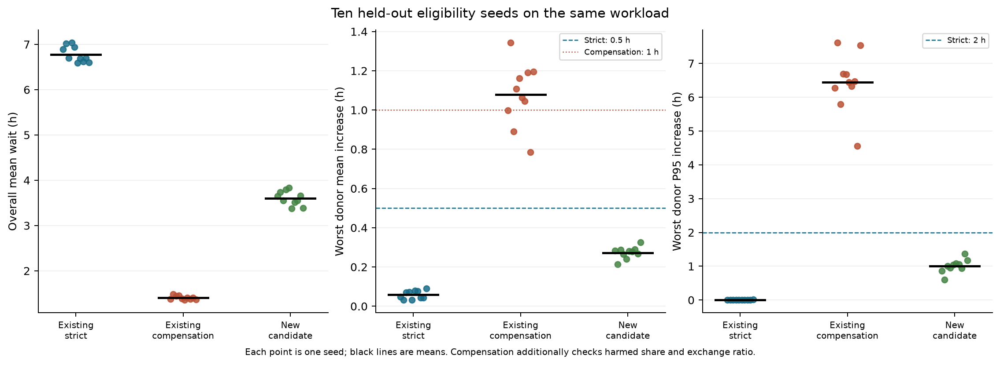
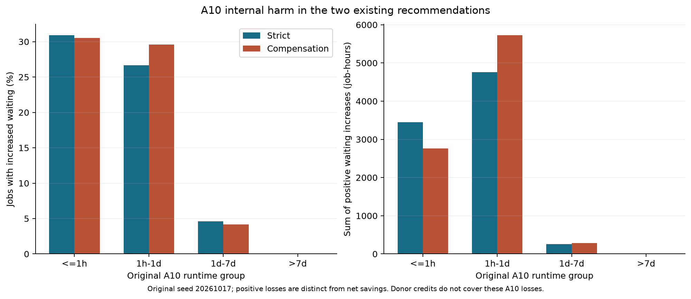

# Additional experiments: eligibility validation and source-pool harm

20 October 2026. D028 reopened experimentation with a fixed three-hour budget. The node-level scheduler, Q2 log-aging T=7 days, raw trace, and historical outputs remain unchanged. These experiments assess eligibility uncertainty on the same workload, not generalization across independent workloads.

The new candidate passes strict criteria in 10/10 new eligibility seeds. Its across-seed overall mean waiting is 3.605 h, compared with 6.779 h for the existing 60-day rule, a 46.83% reduction. The new candidate has less donor-service margin and fails strict criteria when migration speed is .8. Its performance advantage is conditional on the declared p=.5 and equal-speed assumptions. The old compensation scheme passes its own criteria in only 3/10 seeds.

## Development and locked choice

Thirteen routing configurations were evaluated on three previously used development seeds. Duration limits of 30, 45, 60, 75 and 90 days were crossed with minimum waits of zero or one hour at a 25% borrowing cap. Three further configurations had no duration limit and caps of 10%, 15% or 25%. All use A100 before H800, eligibility p=.5 and equal speed. Each development seed must satisfy positive A10 benefit, donor mean increases at most .5 h and marginal P95 increases at most 2 h. The feasible configuration with greatest average A10 gain was selected, with declared ties.

The locked choice is **d75_t0h**. Ten subsequent eligibility seeds were excluded from this choice; no reselection follows validation.

| Configuration | All 3 strict passes | Mean A10 gain (h) | Worst donor mean cost (h) |
| --- | --- | --- | --- |
| d30_t0h | True | 30.9323 | 0.0000 |
| d30_t1h | True | 29.4580 | 0.0000 |
| d45_t0h | True | 41.0048 | 0.0001 |
| d45_t1h | True | 39.6098 | 0.0001 |
| d60_t0h | True | 49.1374 | 0.0670 |
| d60_t1h | True | 47.8117 | 0.0419 |
| d75_t0h | True | 55.7730 | 0.3232 |
| d75_t1h | True | 54.3334 | 0.2459 |
| d90_t0h | False | 58.2909 | 0.4858 |
| d90_t1h | False | 56.7019 | 0.4324 |
| unlimited_cap10 | True | 38.3735 | 0.0922 |
| unlimited_cap15 | False | 50.5624 | 0.7685 |
| unlimited_cap25 | False | 60.1793 | 1.3145 |

## Held-out eligibility results

| Role | Configuration | Passes | Wilson 95% | Overall mean wait (h) | Worst donor mean range (h) |
| --- | --- | --- | --- | --- | --- |
| existing_strict | d60_t0h | 10/10 | 72.2%–100.0% | 6.779 | 0.032–0.091 |
| existing_compensation | unlimited_cap25 | 3/10 | 10.8%–60.3% | 1.406 | 0.785–1.343 |
| new_candidate | d75_t0h | 10/10 | 72.2%–100.0% | 3.605 | 0.213–0.326 |

Existing strict and new candidate use strict criteria. Existing compensation uses exchange ≥100, each donor mean increase ≤1 h and each donor harmed fraction ≤20%; all require positive A10 benefit. Wilson 95% intervals describe a binomial pass probability under the assumed eligibility sampling model. They do not quantify workload generalization, and ten successes do not establish certainty. Eligibility hashes alter participating jobs; the workload and capacities are unchanged.



## Runtime sensitivity

The locked candidate is tested at speeds .8 and 1.25 with seed 20261020. Migrated runtime is original runtime divided by speed. This is a declared sensitivity, not measured hardware performance or another selection stage.

| speedup | wait_hours_mean | max_donor_mean_wait_delta_hours | max_donor_p95_delta_hours | strict_feasible |
| --- | --- | --- | --- | --- |
| 0.8 | 3.7467 | 0.8181 | 5.1730 | False |
| 1.25 | 3.5910 | 0.1051 | 0.0000 | True |

## Source-pool harm

| Scheme | Harmed A10 jobs | Feasible behind blocked head | Not placeable at snapshot | A10 positive loss (job-h) | Harmed among stayed A10 | Short-job net savings (job-h) |
| --- | --- | --- | --- | --- | --- | --- |
| existing_strict | 30375 | 449 | 29926 | 8462.737 | 47.85% | -584.064 |
| existing_compensation | 30342 | 431 | 29911 | 8768.038 | 36.03% | 27.875 |

For each harmed A10 job in the original two recommendations, the changed schedule is reconstructed at that job's baseline start time, after simultaneous events. Only a small fraction are then individually placeable behind an infeasible higher-priority head. Most are not placeable on the realized changed timeline. This supports a limited local head-blocking diagnosis, not attribution of all additional waiting to wide queue heads. Earlier blocking and altered resource-release paths can still contribute indirectly. Donor credits exclude these A10 internal losses; positive loss totals differ from net savings. Negative short-job net savings mean that group's mean waiting increased.



## Reproducibility and limits

Protocol, configuration manifests, scalar metrics, full first-seed schedules, and independent verification are in outputs/v4_validation. Saved full cases receive CSV/Decimal node-capacity and paired-ledger audits; metric-only cases are not counted as independently audited schedules. All historical output hashes are checked. Snapshot category arithmetic is checked for every harmed job, with independent exact resource/head reconstruction for six published examples per existing policy. This does not independently replay every snapshot or prove causality or global optimality.

For a data-free supplement with original inputs supplied separately, `python src/reproduce_v4_full.py` rebuilds Q2* and the three locked first-validation-seed cases in a fresh outputs/v4_reproduction directory, checks the baseline hash and ten scalar metrics per case, and preserves original evidence. Then run the independent schedule auditor for each case path in reproduction_check.json. It does not rerun all 71 experiments or reconstruct historical v3 inputs for source-harm analysis.

```powershell
.\.venv\Scripts\python.exe src\run_v4_validation.py --phase all --workers 2
.\.venv\Scripts\python.exe src\analyze_v4_harm.py
.\.venv\Scripts\python.exe -m unittest discover -s tests -p 'test_*.py'
.\.venv\Scripts\python.exe tests\verify_v4_outputs.py --audit-schedules
.\.venv\Scripts\python.exe src\report_v4_validation.py
```

AI assistance: Codex implemented and executed the experiments, validations, figures and drafts. The team must verify assumptions, interpretation, references and final disclosure. No files were submitted to the competition system.
