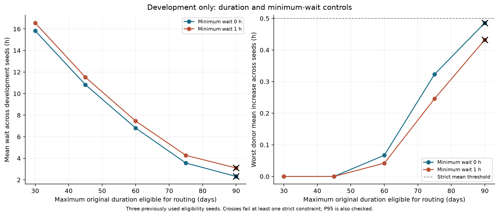

# v4：重新开放实验后的开发、验证与受损机制

日期：2026-10-20。规则：[D028](../DECISIONS.md)。原始数据、冻结调度核心、Q2*=T7d和历史实验保持不变。这里新增的是分流配置搜索与资格随机集合验证，不是独立工作负载验证。所有调度覆盖全部224,112个作业至完工。

**主要结果：** 新候选在十个新资格种子中通过严格门槛10/10，总体平均等待跨种子均值为3.605小时；原60天方案为6.779小时，新候选降低46.83%。其donor代价更接近门槛，且速度降至.8时失去严格可行性。因此可作为p=.5、速度1假设下的性能更优候选，原60天方案仍提供更大的已观察服务余量。原补偿方案仅3/10通过补偿门槛，不能作为稳健默认方案。

## 设计与选择

13个预先登记配置×3个已使用的开发种子，共39次运行。Dmax=30/45/60/75/90天分别配τ=0/1h、cap=.25；另无限时长cap=.10/.15/.25。均A100→H800、p=.5、速度1。三个种子全部通过严格门槛且A10收益均为正才合格，最大化跨种子的平均A10收益，再按最坏donor均值和名称破平局。

开发阶段固定选择 **d75_t0h**。十个验证种子20261020–20261029从未用于此选择；验证后不重新选型。

| Configuration | All 3 strict passes | Mean A10 gain (h) | Worst donor mean cost (h) |
| --- | --- | --- | --- |
| d30_t0h | True | 30.9323 | 0.0000 |
| d30_t1h | True | 29.4580 | 0.0000 |
| d45_t0h | True | 41.0048 | 0.0001 |
| d45_t1h | True | 39.6098 | 0.0001 |
| d60_t0h | True | 49.1374 | 0.0670 |
| d60_t1h | True | 47.8117 | 0.0419 |
| d75_t0h | True | 55.7730 | 0.3232 |
| d75_t1h | True | 54.3334 | 0.2459 |
| d90_t0h | False | 58.2909 | 0.4858 |
| d90_t1h | False | 56.7019 | 0.4324 |
| unlimited_cap10 | True | 38.3735 | 0.0922 |
| unlimited_cap15 | False | 50.5624 | 0.7685 |
| unlimited_cap25 | False | 60.1793 | 1.3145 |



## 固定方案在十个新资格种子上的结果

| Role | Configuration | Passes | Wilson 95% | Overall mean wait (h) | Worst donor mean range (h) |
| --- | --- | --- | --- | --- | --- |
| existing_strict | d60_t0h | 10/10 | 72.2%–100.0% | 6.779 | 0.032–0.091 |
| existing_compensation | unlimited_cap25 | 3/10 | 10.8%–60.3% | 1.406 | 0.785–1.343 |
| new_candidate | d75_t0h | 10/10 | 72.2%–100.0% | 3.605 | 0.213–0.326 |

existing_strict和new_candidate按严格门槛（每donor均值≤.5h、边际P95≤2h）统计；existing_compensation按原补偿门槛（交换比≥100、每donor均值≤1h、受损比例≤20%）统计，均另要求A10净收益>0。全部逐种子结果和两种门槛都保存在[验证表](../outputs/v4_validation/validation.csv)。门槛未放宽。Wilson区间是假定资格哈希抽样下的二项通过率区间；十次全通过也不能解释为100%可靠，更不是跨trace泛化。


本轮独立于开发的是资格集合，不是提交时间、请求资源、作业时长或节点容量；这些保持同一条历史轨迹。若后续根据验证失败重新选型，必须再设新验证集合，不能把本表继续当未使用验证。

## 速度假设的负向与正向压力

固定开发选择，使用验证首种子20261020，仅改变迁入速度为.8或1.25；不再选择参数。速度.8意味着迁入运行时间除以.8，比原时长更长。

| speedup | wait_hours_mean | max_donor_mean_wait_delta_hours | max_donor_p95_delta_hours | strict_feasible |
| --- | --- | --- | --- | --- |
| 0.8 | 3.7467 | 0.8181 | 5.1730 | False |
| 1.25 | 3.5910 | 0.1051 | 0.0000 | True |

这些是统一速度情景，不是实际硬件性能；没有估计显存、网络、搬运成本或定价弹性。

## A10内部损失：证据收紧原解释

| Scheme | Harmed A10 jobs | Feasible behind blocked head | Not placeable at snapshot | A10 positive loss (job-h) | Harmed among stayed A10 | Short-job net savings (job-h) |
| --- | --- | --- | --- | --- | --- | --- |
| existing_strict | 30375 | 449 | 29926 | 8462.737 | 47.85% | -584.064 |
| existing_compensation | 30342 | 431 | 29911 | 8768.038 | 36.03% | 27.875 |

在每个受损作业的**无分流基线启动时刻**，从已有完整分配表重建新方案所有已发生启动/结束后的逐节点资源，并按log-aging键找当时仍在等待的队首。绝大部分受损作业在该时刻本身不可放置；只有小部分满足“自身可放置且更高优先级队首不可放置”的直接瞬时阻塞证据。不能将全部损失归因为宽作业队首阻塞，也不能从此诊断排除更早阻塞或其他路径依赖的间接影响。此检查只解释局部状态，不拆解整个等待差的因果贡献。

分组结果进一步区分迁出作业与留在A10的作业、原时长和总GPU数。≤1h组的净节省若为负，表示该组平均等待上升，即使全体A10净收益很大。donor积分C未包含A10内部正损失。完整快照、分组和每类三个最大损失案例见[受损诊断目录](../outputs/v4_validation/harm_diagnostics)。


## 验证、复现与论文整合

独立验收passed=True；67,743项总账/协议/快照等核对，3份新完整调度共17,641,998项Decimal审计；68个仅指标结果不计为逐节点独立审计通过。1272份历史输出文件哈希未变。

机制诊断的全部分类逻辑已核对，每个现有方案的六个案例另以Decimal重建资源与队首；不冒称独立重算了全部快照。完整审计验证可行性与积分守恒，不证明最优或真实兼容。

```powershell
.\.venv\Scripts\python.exe src\run_v4_validation.py --phase all --workers 2
.\.venv\Scripts\python.exe src\analyze_v4_harm.py
.\.venv\Scripts\python.exe -m unittest discover -s tests -p 'test_*.py'
.\.venv\Scripts\python.exe tests\verify_v4_outputs.py --audit-schedules
.\.venv\Scripts\python.exe src\report_v4_validation.py
```

协议在[protocol.json](../outputs/v4_validation/protocol.json)，记录登记时刻、三小时预算、配置、种子和阈值。原实验runner在相同源码/配置/输入下复用已完成证据，不覆盖不匹配结果；原三小时预算过后不启动新仿真。已有历史输出文件哈希记录在historical_hashes.json。

从精简补充包重建三份锁定验证安排时，另运行 `python src/reproduce_v4_full.py`：它在新目录重建Q2*基线并核对其冻结哈希，再复现三个方案的首个验证种子，逐项核对十个核心指标。输出位于 `outputs/v4_reproduction/<时间>/`，对reproduction_check.json中的每个case路径运行 `python tests/verify_schedules.py --scenario-dir <路径>`。这是新三小时复现预算，不重新搜索或选型，也不改写旧结果；它不重建全部71次实验或历史机制分析所需的v3完整CSV。

统稿时应同时修正：分配率不等于完成作业吞吐量；α=100来自最大等待与全部完工时间双约束；p=.5按作业定义，不能直接推导半数用户或最优折扣；C/S是名义等待积分比，非实际现金成本；T7d不是原T网格的范围端点。成员信息和实际人工核验范围仍由参赛队填写。

AI记录：Codex登记并实现本轮脚本、运行实验、计算与验证结果、绘图及撰写本说明；参赛队仍需核对假设、结论与提交材料。不提交、不推送、不修改外部内容。
