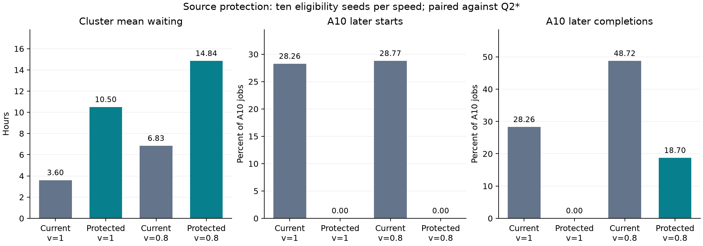

# A10内部等待保护实验

开发阶段锁定 **loans512**。在十个未用资格种子、两种速度的20次验证中，A10零正等待损失为20/20，同时满足donor门槛、A10净收益及总体等待门槛为20/20。 空位扫描上限为512个作业，donor双资源借用比例上限为0.25。 保护参照是不分流的Q2*，不是保证所有作业都比旧分流方案更早启动。等待改善与完成时间改善分开评价。

## 验证结果

以下平均值按十个资格种子等权汇总。donor列取跨种子、逐目标池的最大增量；门槛为均值≤0.5小时且边际P95≤2小时。正等待损失先对每个作业取正值再求和，不被其他作业的收益抵消。

| 方案 | 速度 | 总体平均等待 h | A10更晚启动 % | 正等待损失 作业小时 | A10更晚完成 % | donor最大均值增量 h | donor最大P95增量 h | donor通过数 |
|---|---:|---:|---:|---:|---:|---:|---:|---:|
| 当前75/30天 | 1 | 3.598098 | 28.2580 | 8796.710 | 28.2580 | 0.221067 | 0.510278 | 10/10 |
| loans512 | 1 | 10.495106 | 0.0000 | 0.000 | 0.0000 | 0.233660 | 0.590556 | 10/10 |
| 当前75/30天 | 0.8 | 6.834822 | 28.7697 | 9045.850 | 48.7163 | 0.287638 | 1.042708 | 10/10 |
| loans512 | 0.8 | 14.839447 | 0.0000 | 0.000 | 18.6977 | 0.292788 | 1.268125 | 10/10 |

速度1时，总体平均等待从3.598098变为10.495106小时（+191.68%）；候选跨种子等待范围10.096663–10.877505小时。平均最终完工时间为211.091707→247.106285天；跨种子最坏的最大等待为661.763333→1514.551111小时，第90天完成作业数的跨种子均值为218091.6→217654.1。

速度0.8时，总体平均等待从6.834822变为14.839447小时（+117.12%）；候选跨种子等待范围14.425671–15.255131小时。平均最终完工时间为216.842653→247.106285天；跨种子最坏的最大等待为813.261667→1514.551111小时，第90天完成作业数的跨种子均值为217424.6→216918.4。

速度0.8意味着迁移后执行时长为原时长的1.25倍。即使启动不晚，迁出作业仍可能更晚完成；这一残余损失已单列，不能把等待保护写成全口径无损。表中比例以全部111,284个A10作业为分母。



速度0.8的分组结果如下，比例为每个组内比例的跨种子均值。时长分组按未迁移的原始执行时长定义；migrated/stayed按实际迁移结果分类，是描述性分组，不作为迁移因果效应。两速度全部分组见[分组汇总](../outputs/v6_source_protection/validation_group_summary.csv)。

| 方案 | 分组 | 更晚启动 % | 正等待损失 作业小时 | 净等待节省 作业小时 | 更晚完成 % |
|---|---|---:|---:|---:|---:|
| current | 1d_7d | 4.9256 | 352.460 | 815260.125 | 16.4910 |
| current | 1h_1d | 29.1697 | 4899.145 | 240855.739 | 54.9180 |
| current | gt7d | 0.0149 | 1.150 | 4418032.761 | 0.5276 |
| current | le1h | 32.4368 | 3793.095 | -1015.824 | 53.8608 |
| current | migrated | 0.5294 | 181.754 | 2568249.181 | 49.4425 |
| current | stayed | 48.2187 | 8864.095 | 2904883.620 | 48.2187 |
| loans512 | 1d_7d | 0.0000 | 0.000 | 572094.342 | 11.5468 |
| loans512 | 1h_1d | 0.0000 | 0.000 | 129746.631 | 25.2021 |
| loans512 | gt7d | 0.0000 | 0.000 | 2974851.628 | 0.5126 |
| loans512 | le1h | 0.0000 | 0.000 | 2034.581 | 19.9154 |
| loans512 | migrated | 0.0000 | 0.000 | 2585984.412 | 46.1395 |
| loans512 | stayed | 0.0000 | 0.000 | 1092742.770 | 0.0000 |


## 在线机制与适用边界

独立影子队列只接收当前已到达的A10作业，按Q2*的对数aging T7d及原节点放置规则运行。影子作业开始时，若实际作业还在等待，就在相同节点立即启动；如果它已经迁出或提前启动，则相应影子占用区间可以形成临时空位。实际候选必须在每个借用节点的区间结束前完成，保留多worker同启和CPU容量约束。源池扫描范围固定为到达顺序队列的前128或512个等待作业，再按时长优先尝试。

该机制不读取预先计算的基线启动时刻，也不读取未来到达。基线CSV只用于事后配对评价。保护成立的归纳条件是：影子要求的物理节点从未被越期借用；同一时刻先归还实际资源，再处理影子完成与启动。未提前启动的作业因此保留原启动机会。当前实现明确要求A10每节点1 GPU，符合全部2,494个A10节点；不直接推广到多GPU节点或执行时长预测有误的系统。CPU请求为小数或零均保留。

平均等待增加的机制是保留了已经迁出作业的影子占用：空闲节点只能接受能在预约到期前完成的作业，较长或较宽的作业可能无法利用这些区间。原分流允许更自由地重新安排，因此能获得更大的平均收益，也可能让另一批A10作业稍晚启动。零等待损失是明确的公平性取舍，本轮不据此自动替换追求较低平均等待的现方案。

仅在首验证种子20261033的完整配对中，1,909个原时长超过75天的A10作业全部保留Q2*启动时刻。这组作业对相对现方案新增总等待的贡献为：速度1时58.23%、速度0.8时38.52%。新增总等待按全体作业的等待差求和，这一分解仅描述首种子，见[长作业代价分解](../outputs/v6_source_protection/long_job_tradeoff_first_seed.csv)。

原始时长超过75天的作业继续留在A10，未裁剪或删除。donor仍为A100→H800，资格比例假设为0.5，实际执行时长准入分别为75天与30天。速度、兼容资格和准确运行时长仍是建模假设；所有作业运行至完成，不以提交窗口截断。等待及完成损失均以小时计，最终完工以相对原始时间原点的天计。

## 开发选择和证据范围

协议先登记六个方案、三个既用开发资格种子20261030–20261032及速度1和0.8，共36次。联合合格条件为A10逐作业零正等待损失、A10净收益>0、总体平均等待不高于Q2*的31.189516小时，且donor两门槛均通过；合格者按开发平均等待最小锁定，名称用于平手排序。独立验证使用20261033–20261042，没有利用验证再次调参。

| 方案 | 六情景平均等待 h | 最坏donor均值增量 h | 最坏donor P95增量 h | 联合通过数 |
|---|---:|---:|---:|---:|
| current | 5.127494 | 0.214863 | 0.508611 | 0/6 |
| loans128 | 18.275339 | 0.228921 | 0.457833 | 6/6 |
| loans128_cap10 | 27.181835 | 0.036615 | 0.001111 | 6/6 |
| loans128_cap15 | 21.654793 | 0.385047 | 1.777569 | 6/6 |
| loans512 | 12.616067 | 0.203599 | 0.457833 | 6/6 |
| shadow | 19.002953 | 0.228921 | 0.457833 | 6/6 |

种子只改变同一trace中的假定迁移资格，不是20份独立工作负载。每个速度十次验证不能证明对任意资格集合均有效，也不支持全局最优结论。实现采用独立实验引擎保存冻结历史语义，保留公共存储和审计接口；没有把这一实验扩展称为完整内核重构。

## 复核与复现

187项单元测试通过。关闭保护时16份完整历史安排共72,603,825字段精确一致，2,372份既有文件哈希不变。本轮4份完整安排通过23,897,403项独立Decimal审计，其余72次仅保存指标，不冒充逐节点独立审计。新增验收252,508项检查零失败，其中18,622个实际空位借用分配独立核对基线可回收区间。完整案例逐A10作业启动时刻也按Decimal直接比较。

另对开发情景loans512、种子20261030、速度0.8做完整工程复现：75项原指标一致，新安排通过5,996,651项独立Decimal审计；再次调用全部命中缓存，20个文件不变。这不计为新增资格样本，见[复现核对](../outputs/v6_source_reproduction/cases/development_loans512_s20261030_v0.8/reproduction_check.json)。

```text
python -m unittest discover -s tests -p "test_*.py"
python tests/verify_v6_outputs.py
python src/reproduce_source_case.py --scenario outputs/v6_source_protection/cases/validation_loans512_s20261033_v0.8/scenario.json
python src/run_v6_source_protection.py --output outputs/v6_source_protection_reproduction --phase all
python tests/verify_v6_outputs.py --output outputs/v6_source_protection_reproduction
```

单案例复现使用专用适配器显式恢复source_protection；冻结通用SimulationSpec尚不包含该字段。全实验重放应使用新目录，重新登记两小时预算；已有案例可在同一协议下复用。需要原始数据、Q2*完整参考以及协议所列历史回归安排。

输入目录：`2026_MCM_Senior_GPU_Scheduling/2026_MCM_Senior_GPU_Scheduling/`。

- `job_info_clean.csv`: `735bc06c3986b1d0c5932236f8685b7204463829118fc6a1d37030e253ed38e1`
- `node_info_df.csv`: `1aba161961a5a4a1a61aa581383c5e5abe3400b59f8597ba8c4eef7597bc9d18`

实现、验证器与基线哈希见[协议](../outputs/v6_source_protection/protocol.json)，完整核验见[验收](../outputs/v6_source_protection/verification.json)，逐案例来源与文件收据在cases目录。主论文和既有补充ZIP保留历史版本，尚未吸收本轮结果。AI辅助完成实现、实验与分析；参赛队需人工确认运行时长、速度/兼容假设、门槛和论文措辞。
