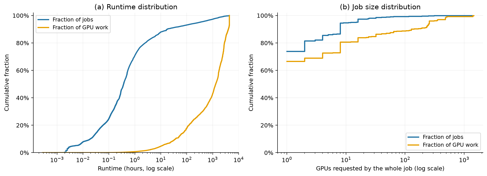
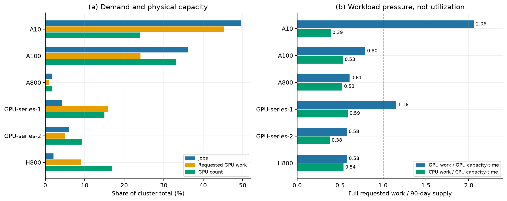
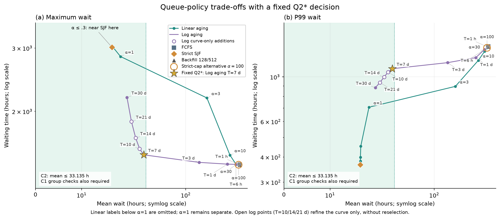
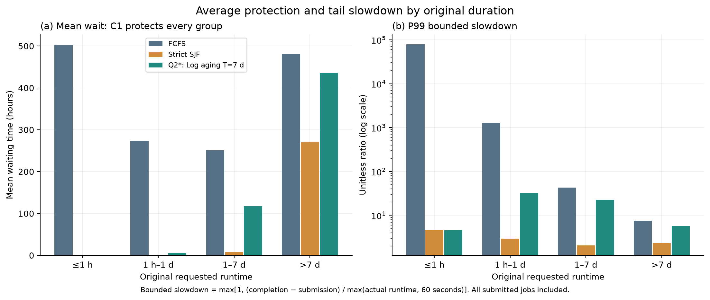
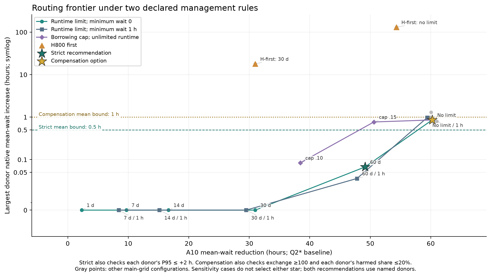

> **Superseded.** The final submitted paper is `reports/paper/paper.tex` / `paper.pdf`. This Markdown file is an earlier, longer draft kept for reference.

# Balancing Response Time and Extreme Delays in a Heterogeneous GPU Cluster

**2026 MCM Senior Group — Problem B: Scheduling a GPU Cluster**

Team members: *[Name 1], [Name 2], [Name 3]*

> Draft of 17 October 2026, assembled from the frozen experiment outputs. All numbers come from the files listed in the reproducibility appendix. Items in *[brackets]* need completion by the team before submission. Target length after typesetting: at most 10 A4 pages, 11 pt font.

---

## Summary

We study a three-month trace of 224,112 jobs on 4,278 GPU servers (10,412 GPUs, six GPU models). **Data.** Demand is highly concentrated and badly matched to capacity. Jobs longer than seven days are 6.0% of submissions but carry 77.0% of GPU work. The A10 pool holds 24.0% of the GPUs, yet its jobs request 2.06 times the pool's 90-day GPU supply; every other pool except GPU-series-1 stays below 0.8. **Scheduling.** We build an exact event-driven simulator with node-level gang placement and no preemption. Because the A10 pool is saturated (99.9% allocated), queue order decides *who* waits, not how much work is done. Shortest-job-first cuts the mean wait from 447 h (first-come-first-served, FCFS) to 16.6 h and helps every runtime class on average, but leaves months-long jobs waiting up to 3,017 h. A logarithmic aging rule (priority $\ln d_j + a_j/T$, $T=7$ days) keeps the mean at 31.2 h while cutting the maximum wait to 1,515 h, close to FCFS. **Imbalance.** We let a share of A10 jobs run on idle A100 and then H800 GPUs, pulling them from the A10 queue whenever donor capacity frees up. Routing only jobs with runtimes of at most 60 days lowers the overall mean wait from 31.2 h to 6.8 h, the maximum from 1,515 h to 789 h, and the time to finish all jobs from 247 to 217 days. Native A100/H800 users see their mean wait rise by at most 0.07 h. A version without the runtime limit performs better still, but it would require compensating donor-pool users; we quantify this with an auditable delay-credit account.

---

## 1. Problem Setting and Assumptions

Each job $j$ has a GPU model $k(j)$, per-worker requests $g_j$ GPUs and $c_j$ vCPUs, $m_j$ identical workers, submission time $a_j$ and runtime $d_j$. All workers of a job start together. Workers may sit on different nodes, but each worker's CPUs and GPUs must be on one node of the requested model. Jobs are never preempted. Following the problem statement, we assume that

- all nodes are idle at $t=0$;
- runtimes are known on submission;
- a scheduler may use only jobs that have already arrived.

We also make three assumptions of our own:

1. The 90-day trace is a closed workload. Every job is scheduled until completion, and we never truncate at day 90.
2. Results are reported in two windows: within $[0, 90\text{ d})$ (completions, allocation), and over the whole run until the last job ends (waiting times).
3. In Question 3, cross-model compatibility, equal speed and zero migration overhead are *scenario assumptions*, not measured facts.

---

## 2. Question 1 — Understanding the Data

**Validation.** There are no missing values, duplicate IDs or unknown models. Every job fits its own model's pool when that pool is empty. We keep the 73 fractional and one zero CPU request as given, and we remove no extreme job: the long tail is the main source of congestion, not noise.

**Work, not job counts, drives congestion.** We measure job $j$'s GPU work as $W_j = g_j m_j d_j$. Total requested GPU work is 24.6 million GPU-hours. Runtime is extremely skewed: the median job runs 22 minutes, while the longest runs about 184 days. Jobs of at most one hour make up 70.8% of submissions but only 0.7% of GPU work; jobs over seven days make up 6.0% of submissions and 77.0% of work. Concentration is just as strong when jobs are ranked by work: the top 1%, 5% and 10% contribute 43.3%, 87.7% and 97.1% of GPU work (Gini coefficient 0.952). Large work usually means *long* jobs rather than *wide* ones: 73.9% of jobs ask for a single GPU in total. H800 is the exception, with 61.9% multi-worker jobs and one job requesting 1,456 of its 1,752 GPUs.

*Figure 1. Cumulative shares of jobs and of GPU work, by runtime and by whole-job GPU demand.*

**Supply and demand are badly mismatched across models.** For model $k$ we define the workload-to-capacity ratio

$$
\rho_k=\frac{\sum_{j:k(j)=k} W_j}{90\text{ days}\times \sum_{n:k(n)=k} G_n},
$$

where $G_n$ is node $n$'s GPU count. The numerator counts each job's full runtime, including work beyond day 90, so $\rho_k$ is a demand diagnostic, not a utilization.

| GPU model | GPUs | Jobs | $\rho_k$ (GPU) | $\rho_k$ (CPU) |
|---|---:|---:|---:|---:|
| A10 | 2,494 | 111,284 | **2.064** | 0.391 |
| A100-SXM4-80GB | 3,456 | 80,877 | 0.795 | 0.534 |
| A800-SXM4-80GB | 176 | 3,959 | 0.611 | 0.526 |
| GPU-series-1 | 1,558 | 9,643 | 1.156 | 0.590 |
| GPU-series-2 | 976 | 13,633 | 0.580 | 0.382 |
| H800 | 1,752 | 4,716 | 0.582 | 0.540 |

A10 carries 45.2% of all GPU work on 24.0% of the GPUs. To separate the timing of demand from its total, we also compute the GPU demand that would exist if every job started on submission. This curve ignores capacity, so it is a diagnostic, not a feasible schedule. On average over the window, A10 demand is 1.45 times capacity, and it stays above capacity for 99.6% of the window. GPU-series-1, by contrast, peaks at only 0.95 times capacity, so its $\rho_k>1$ comes from long jobs running past day 90 rather than from overload inside the window.

*Figure 2. Demand composition and workload-to-capacity ratio by GPU model.*

**Time structure.** Exactly 3,512 jobs, carrying 23.1% of all work, are submitted at $t=0$; the data do not say why. Even if every job started immediately, 26.6% of GPU work would fall after day 90. With fixed capacity and strict model matching, the A10 work alone implies that the last job cannot finish before day **185.8**. This lower bound is the benchmark for the completion times in Questions 2 and 3.

**Implications.** (i) The A10 pool is overloaded on capacity grounds, so no queue order can remove its backlog. (ii) The long tail dominates work, so evaluation must look at long-job waiting as well as averages. (iii) Idle capacity on other models suggests rebalancing, which is the subject of Question 3.

---

## 3. Question 2 — Scheduling and Placement

### 3.1 Feasibility and placement

Let $\hat G_n,\hat C_n$ be node $n$'s currently free GPUs and vCPUs. The number of workers of job $j$ that node $n$ can host is

$$
q_{jn}=\min\Big(\big\lfloor \hat G_n/g_j\big\rfloor,\ \big\lfloor \hat C_n/c_j\big\rfloor\Big)
$$

(the CPU term is dropped when $c_j=0$). Job $j$ can start now **if and only if** $\sum_{n:k(n)=k(j)} q_{jn}\ge m_j$. The condition is exact because all workers of a job are identical and there are no topology constraints. For placement we use *best fit*: workers are put first on the feasible nodes with the fewest free slots, which keeps whole nodes free for wide jobs. Ties are broken deterministically, so every run is reproducible.

### 3.2 Event-driven simulator

The simulator jumps between arrival and completion events instead of stepping through time. At each event time it

1. releases every job that completes at that time;
2. adds every job that arrives at that time to its model's queue;
3. dispatches each affected pool.

It runs until every job has finished. One full run over 224,112 jobs takes about 6–30 s. We check every saved schedule with an independent auditor that uses exact decimal arithmetic and does not import the simulator code. The auditor rebuilds per-node GPU and CPU occupancy and verifies: capacity limits, simultaneous worker start, start ≥ submission, runtime, and model compatibility.

### 3.3 Queue policies

All policies share the placement rule above and differ only in how they order the queue.

- **FCFS.** The oldest waiting job is the queue head; if it cannot be placed, the pool waits ("strict head blocking").
- **SJF.** The head is the waiting job with the shortest runtime, again with strict head blocking.
- **Backfill.** This variant protects the FCFS head. From running jobs' known end times we compute the head's earliest feasible start $t^*$. A later job may start now only if it can be placed now *and* $t+d_j\le t^*$, so it can never delay the head.
- **Aging.** Priority score $s_j(t)$, with smaller scores served first. Because the term involving $t$ is the same for every waiting job, each score is equivalent to a static key, and a single heap suffices:
  - linear: $s_j(t)=d_j-\alpha(t-a_j)$, equivalent to the key $d_j+\alpha a_j$;
  - logarithmic: $s_j(t)=\ln d_j-(t-a_j)/T$, equivalent to the key $\ln d_j + a_j/T$.

  With logarithmic aging, a job submitted $T\ln(d_L/d_S)$ earlier ranks ahead of a later job that is $d_L/d_S$ times shorter. Waiting therefore compensates *ratios* of runtime, which suits runtimes spanning six orders of magnitude.

### 3.4 Results

**Saturation explains why backfill helps so little.** Under FCFS the A10 pool is 99.93% allocated over 90 days. While its queue is non-empty, it is idle for only 1,530 GPU-hours (0.03% of its capacity). Backfill can only fill idle resources, so it reduces the mean wait by just 0.26% (0.96% with a 512-job look-ahead). For the same reason, FCFS and SJF allocate almost identical shares of the cluster (69.46% vs 69.44%). Their very different waiting times come from *order*, not throughput.

| Policy | Mean wait (h) | P99 wait (h) | Max wait (h) | Mean bounded slowdown | Completed by day 90 | Last completion (day) |
|---|---:|---:|---:|---:|---:|---:|
| FCFS | 447.3 | 1,416.3 | 1,423.3 | 6,516 | 164,886 | 243.3 |
| SJF | 16.6 | 366.3 | 3,017.3 | 1.22 | 217,494 | 309.7 |
| Linear aging, $\alpha=1$ | 18.4 | 707.0 | 2,841.8 | 2.34 | 217,192 | 302.4 |
| **Log aging, $T=7$ d (Q2\*)** | **31.2** | 1,097.6 | **1,514.6** | 1.45 | 215,229 | **247.1** |
| Linear aging, $\alpha=100$ | 432.9 | 1,393.8 | 1,421.4 | 6,221 | 165,868 | 243.2 |

*Bounded slowdown is $\max\{1,(\text{end}-\text{submit})/\max(\text{runtime},60\text{ s})\}$.*

**SJF helps every runtime class on average, but starves a small tail.** Mean waits by runtime class are as follows:

| Runtime class | FCFS (h) | SJF (h) | Q2\* (h) |
|---|---:|---:|---:|
| ≤1 h | 502.8 | 0.03 | 0.03 |
| 1 h – 1 d | 272.9 | 0.28 | 5.68 |
| 1–7 d | 250.8 | 8.3 | 117.8 |
| >7 d | 480.9 | 270.2 | 435.8 |

Matching each job's wait under SJF against its wait under FCFS, only 2,502 jobs (1.12%) wait longer, though they carry 14.8% of GPU work and wait 770 h longer on average. All 1,525 jobs that wait more than 1,000 h under SJF are A10 jobs with runtimes of 49.5–183.5 days. SJF's real cost is therefore a starved tail of months-long jobs, and the maximum wait grows to 3,017 h. The last completion slips to day 310.

**Linear aging cannot fix that tail; logarithmic aging can.** For $\alpha\le0.3$, linear aging behaves like SJF. For $\alpha\ge3$, the mean wait jumps above 180 h and the policy approaches FCFS (Figure 3). The reason is scale: to put a 100-day job ahead of new one-hour jobs, the 100-day job must wait an extra $100/\alpha$ days. Logarithmic aging moves along a much better trade-off curve. With $T=30$ days it reaches a 19.8 h mean and a 2,188 h maximum; with $T=7$ days, a 31.2 h mean and a 1,515 h maximum.

**Selection rule.** We wrote the following rule down before running the logarithmic-aging experiments. A candidate policy must satisfy

- (C1) every runtime class has a mean wait no larger than under FCFS;
- (C2) the overall mean wait is at most twice SJF's (33.1 h).

Among the 22 candidates (FCFS, SJF, two backfill variants, 12 linear and 6 logarithmic aging settings), 11 satisfy both. The selected policy, **Q2\* = logarithmic aging with $T=7$ days**, has the smallest maximum wait among them.

Compared with SJF, Q2\* cuts the maximum wait by 49.8% and brings the last completion within four days of FCFS. In exchange it spreads the delay more widely:

- P99 wait rises from 366 to 1,098 h;
- P99 bounded slowdown rises from 4.2 to 7.9;
- the number of jobs waiting more than 1,000 h rises from 1,525 to 3,354;
- the number of jobs waiting longer than FCFS's maximum falls from 1,199 to 159.

The choice depends on the 2× budget in C2. A 1.5× budget selects $T=30$ days instead, while 3× still selects $T=7$ days. A manager who must strictly cap the maximum wait at FCFS's level would be left with $\alpha=100$, which is essentially FCFS. We therefore present Q2\* as one point on an explicit trade-off curve, not as a universal optimum.

*Figure 3. Mean versus maximum wait (a) and mean versus P99 wait (b) for linear and logarithmic aging, with FCFS, SJF and backfill marked. The shaded area satisfies C2; C1 is checked separately. The T = 10, 14 and 21 day points only show the shape of the curve and were not candidates for selection.*

*Figure 4. Mean wait and P99 bounded slowdown by runtime class for FCFS, SJF and Q2\*.*

---

## 4. Question 3 — Reducing Imbalance Across GPU Models

### 4.1 Measuring the imbalance

Let $I_m(t)$ be idle GPUs in pool $m$, and $Q_{A10}(t)$ the GPUs requested by waiting A10 jobs. For the fixed donor set $\mathcal D=\{\text{A100, A800, H800, GPU-series-2}\}$ we compute exactly

$$
I_{\text{strand}}=\int_0^{90\text{ d}}\min\Big(\sum_{m\in\mathcal D}I_m(t),\;Q_{A10}(t)\Big)\,dt .
$$

This integral ignores CPU and packing constraints, so it is only an upper bound on the idle donor capacity that waiting A10 jobs could have used. Under Q2\* without routing, $I_{\text{strand}}=3.68$ million GPU-hours, and the gap between the most- and least-allocated pools is 0.44.

### 4.2 Pull routing

We use a technical approach (cross-model substitution) and evaluate a financial one through an accounting mechanism (Section 4.4).

**Eligibility.** A fixed, hash-based 50% of A10 jobs is *flexible*. We read this share $p$ as the fraction of A10 jobs that are technically compatible and whose owners accept substitution, for example in exchange for a discount. A flexible job uses one donor GPU per A10 GPU with the same CPU request, and runs at the same speed.

**Routing rule.** At every event, after native dispatch:

1. A donor pool is considered only if its *own* queue is empty.
2. The donor pulls the oldest flexible A10 jobs (scanning at most 256) that fit on its nodes right away.
3. Borrowed jobs may occupy at most 25% of the donor's GPUs and vCPUs at any time.
4. A routed job runs to completion on the donor and is never preempted.

**Two levers control the cost to donor users:**

- a runtime limit $D_{\max}$: only flexible jobs with $d_j\le D_{\max}$ may be pulled;
- the donor order: which pool is offered work first.

**Two decision rules, registered before the runs.** Both consider only named donors and require a positive A10 benefit.

- *Strict*: each donor's native mean wait may rise by at most 0.5 h and its native P95 wait by at most 2 h.
- *Compensation*: A10 job-hours saved must be at least 100 times donor job-hours added; each donor's native mean wait may rise by at most 1 h; at most 20% of any donor's native jobs may be delayed.

Under either rule, the configuration with the largest A10 mean-wait reduction is selected. These thresholds are management assumptions, not facts from the problem. All comparisons pair each job with itself under Q2\* without routing.

### 4.3 Results

| Configuration (donors A100 → H800) | Overall mean (h) | A10 mean (h) | Max wait (h) | Last completion (d) | Worst donor Δmean / ΔP95 (h) | Share of A10 work moved | $I_{\text{strand}}$ (M GPUh) |
|---|---:|---:|---:|---:|---:|---:|---:|
| No routing (Q2\*) | 31.2 | 62.4 | 1,514.6 | 247.1 | — | — | 3.68 |
| $D_{\max}=7$ d | 26.4 | 52.7 | 1,445.1 | 244.2 | 0 / 0 | 1.2% | 3.35 |
| $D_{\max}=30$ d | 15.8 | 31.4 | 1,130.1 | 231.1 | 0 / 0 | 7.2% | 2.46 |
| **$D_{\max}=60$ d (strict)** | **6.8** | **13.2** | **788.6** | **216.9** | **0.07 / 0** | 16.1% | 1.33 |
| No limit (compensation) | 1.4 | 2.1 | 494.5 | 204.6 | 0.86 / 5.84 | 28.5% | 0.26 |

*Figure 5. Routing trade-off curve: A10 mean-wait reduction versus the largest increase in donor-native mean wait. Each line is one family of configurations; the stars mark the two recommendations.*

**The runtime limit is the key lever.** Up to $D_{\max}=30$ days, routing costs donor users nothing, and the trade-off curve in Figure 5 runs along the horizontal axis. At 60 days, routing moves 16% of A10 work, lowers the overall mean wait from 31.2 h to 6.8 h, and brings the last completion to day 216.9. The lower bound of 185.8 days from Section 2 applies only under strict model matching, so it no longer binds once jobs can move. The cluster's 90-day GPU allocation rises from 69.4% to 76.3%. The cost to native donor users is a mean increase of 0.07 h, with no change in P95 wait. Even so, 4.6% of A100 jobs and 0.25% of H800 jobs are delayed somewhat, so the strict recommendation is not literally harmless.

Without the limit, long A10 jobs hold donor GPUs for weeks. The mean wait then falls to 1.4 h, but native H800 users' mean wait rises by 0.86 h, their P95 by 5.8 h, and 17.4% of their jobs are delayed. This configuration fails the strict rule and passes only the compensation rule.

**Other levers.**

- *Borrowing cap alone.* A 10% cap passes the strict rule but yields only a 38.4 h A10 gain (versus 49.1 h for $D_{\max}=60$ d); a 15% cap fails on P95.
- *Minimum wait before routing.* Requiring a 1 h wait before a job may be pulled keeps 97% of the $D_{\max}=60$ d benefit with only 4,977 instead of 47,810 migrations. This is attractive if each migration has an operational cost.
- *Donor order matters a great deal.* Offering H800 first, with no runtime limit, raises the native H800 mean wait by 130 h. A likely cause is that H800 serves very wide gang jobs (up to 1,456 GPUs), which cannot start once borrowed GPUs fragment the pool. We have not verified this mechanism. The safer policy is to borrow first from the pool whose native jobs are narrow (A100).

**A side effect inside the A10 pool.** Although routing cuts the A10 mean wait by 49 h, 27.3% of A10 jobs wait longer (at most 33 h more). When routing removes jobs from the queue, a wide gang job can reach the head of the queue earlier. Under strict head blocking it then holds back jobs behind it. This is an inherent cost of strict blocking, not of routing as such.

### 4.4 Compensation as a financial mechanism

The trace contains no prices, so we propose a **delay-credit** account rather than a fitted pricing model. Let $\Delta w_j$ be job $j$'s change in waiting time relative to Q2\* without routing, and $G_j=g_jm_j$ its whole-job GPU count. Define the credits owed to delayed donor-native jobs, $C=\sum_{j\in\text{donor native}} G_j\max(0,\Delta w_j)$, and the GPU-weighted savings of A10 jobs, $S=\sum_{j\in A10} G_j(-\Delta w_j)$.

| Account | Strict ($D_{\max}=60$ d) | Compensation (no limit) |
|---|---:|---:|
| A10 job-hours saved | 5,467,398 | 6,703,307 |
| Donor job-hours added | 5,422 | 18,443 |
| Exchange ratio (job-hours) | 1,008 : 1 | 363 : 1 |
| Credits $C$ / savings $S$ (GPU-weighted) | 0.63% | 11.6% |

Under the strict plan, crediting every delayed native job in full would cost 0.63% of the GPU-weighted savings. The weighted share is much higher than the unweighted ratio suggests because the delayed donor jobs are wider than typical A10 jobs. Credits could be redeemed as discounts or as priority. We do not simulate how redemption would feed back into scheduling, and credits are not evidence of users' real willingness to pay.

**Participation must be limited, which links pricing to the technical design.** Sensitivity results:

- The strict plan passes its rule under two further random selections of flexible jobs (mean wait 6.65–6.95 h) and at $p=0.25$ (mean wait 16.8 h).
- It fails at $p=1$: native mean +0.89 h, P95 +5.3 h.
- The compensation plan fails under both alternative selections (native mean +1.25 h and +1.31 h).

A discount for flexible A10 users should therefore be offered to a capped share of users, about half, rather than maximized. The compensation plan is a conditional alternative, not a robust default.

---

## 5. Recommendations

1. **Queue policy.** Use logarithmic aging with $T=7$ days in every pool. It keeps the average responsiveness that SJF provides and caps starvation near the FCFS level. If management cares only about the mean, $T=30$ days or SJF is better, at the cost of a long starved tail.
2. **Cross-model routing.** Let a capped share (about 50%) of A10 jobs volunteer for substitution. Pull them onto A100 first and H800 second, only when the donor's own queue is empty. Allow only jobs with runtimes of at most 60 days, and let borrowed jobs use at most 25% of each donor's capacity.
3. **Monitoring.** Track each donor's native mean and P95 wait, the delayed share of its jobs, and the delay-credit ratio $C/S$. Removing the runtime limit should be considered only together with an explicit compensation scheme.

---

## 6. Limitations

- **In-sample tuning.** $T$, $D_{\max}$ and the thresholds were chosen on the same trace they are evaluated on; no temporal hold-out was used. Both selections lie at the edge of the tested range: $T=7$ d depends on the C2 budget, and $D_{\max}=60$ d is the largest finite limit tested.
- **Simplified hardware and runtimes.** Runtimes are treated as exact. GPU memory, network topology, data transfer, migration overhead, failures and MIG partitioning are not modeled. Compatibility and equal speed across models are assumptions.
- **Unaddressed pool.** GPU-series-1 has a full-work ratio of 1.16 and is not addressed.
- **Strict head blocking.** It causes some individual jobs to wait longer even when averages improve.
- **Simulated allocation.** All allocation figures are simulated allocations, not measured hardware utilization.

---

## 7. Reproducibility and Validation

The code (Python 3.12; NumPy, pandas, Matplotlib) reproduces every table and figure from the two supplied CSV files. Commands and the file list are in the supplementary package. Verification included:

- 140 unit tests on mathematical properties and edge cases;
- an independent decimal-arithmetic audit of each saved full schedule (11.7 million checks for the two final recommendations, zero failures);
- an exact replay showing that the final simulator reproduces all earlier schedules (208.7 million fields, zero differences).

Configurations stored as metrics only are not counted as audited.

## References

1. 2026 MCM Senior Group Problem B, *Scheduling a GPU Cluster*, and the supplied `node_info_df.csv` and `job_info_clean.csv`.
2. Alibaba Group, *Alibaba Cluster Trace (GPU)*, https://github.com/alibaba/clusterdata.
3. SchedMD, *Slurm Scheduling Configuration Guide* (backfill and reservations), https://slurm.schedmd.com/sched_config.html.

## Use of AI Tools

*[To be checked and finalized by the team.]* We used AI assistants during this project:

- **Anthropic Claude** helped compare the candidate problems, review intermediate results, write the experiment task specifications, and draft this report.
- **OpenAI Codex** helped write the analysis and simulation code, run the experiments, produce figures, and draft Chinese and English working notes.

All modeling choices, decision thresholds, and compatibility assumptions were reviewed by the team. *[State here which numbers, code and figures team members personally verified.]* The team is responsible for the final content.
