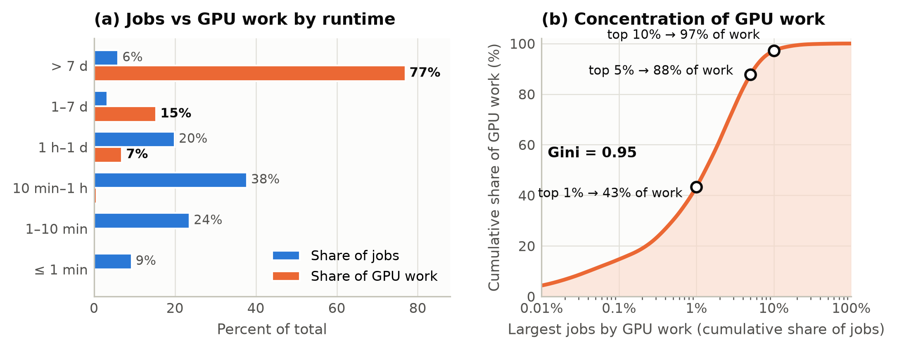
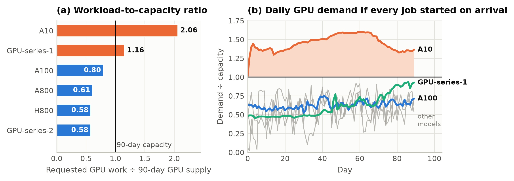
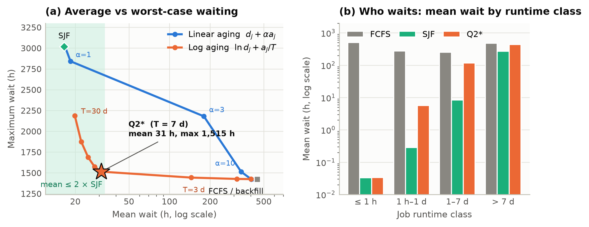
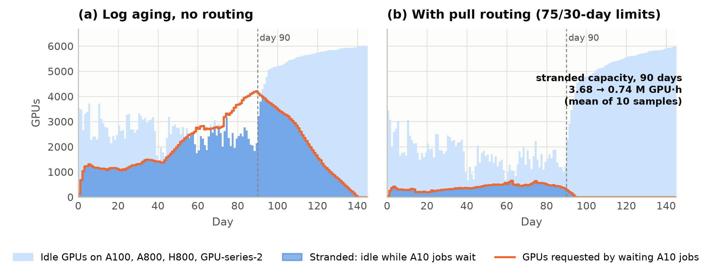
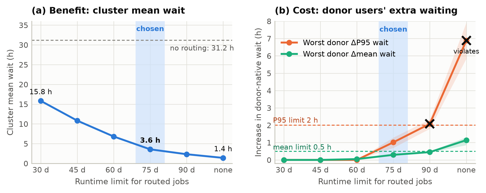
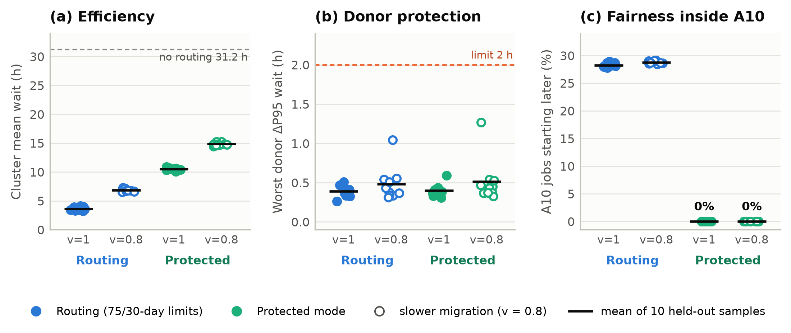

> **Superseded.** The final submitted paper is `reports/paper/paper.tex` / `paper.pdf`. This Markdown file is an earlier, longer draft kept for reference.

# Fast and Fair: Scheduling and Rebalancing a Heterogeneous GPU Cluster

**2026 MCM Senior Group — Problem B**

Team: *[Name 1], [Name 2], [Name 3]*

---

## Summary

We study a three-month trace of 224,112 jobs submitted to 4,278 GPU servers carrying 10,412 GPUs of six models. We first ask where the demand comes from, then how a scheduler should order it, and finally what to do about the imbalance that ordering alone cannot remove.

The data show that GPU work is concentrated in a small number of long jobs and that demand is badly matched to supply. Jobs longer than seven days make up 6.0% of submissions but 77.0% of GPU work. The A10 pool holds 24.0% of the GPUs, yet its jobs request 2.06 times its 90-day supply, while every other pool requests between 0.58 and 1.16 times its own.

To schedule this workload, we formulate placement as a node-level feasibility condition and evaluate queue policies with an exact discrete-event simulator that runs every job to completion. Because the A10 pool is saturated, queue order decides who waits rather than how much work gets done. Shortest-job-first cuts the mean wait from 447 h under first-come-first-served to 16.6 h, but leaves months-long jobs waiting up to 3,017 h. We therefore propose logarithmic aging, which ranks jobs by $\ln d_j + a_j/T$. With $T=7$ days it holds the mean wait at 31.2 h and brings the maximum down to 1,515 h, close to the first-come-first-served level.

Scheduling cannot create A10 capacity, but idle GPUs elsewhere can supply it. In our routing mechanism, A100 and H800 pools whose own queues are empty pull eligible A10 jobs, subject to runtime limits of 75 days on A100 and 30 days on H800. On ten held-out samples of eligible jobs, this reduces the cluster mean wait to 3.6 h and the time to finish all jobs from 247 to 211 days. Native users of the donor pools wait at most 0.22 h longer on average, and the rule continues to meet our service limits when migrated jobs run 20% slower. For operators who require that no A10 job be delayed by routing, a protected variant achieves this at a mean wait of 10.5 h.

**Keywords:** gang scheduling; discrete-event simulation; aging; heterogeneous clusters; workload rebalancing

---

## 1. Introduction

A modern GPU cluster serves jobs that differ by orders of magnitude in size and duration, and it must make three kinds of decisions. It decides which waiting job starts next and on which servers its workers run. When some GPU models are scarce while others sit idle, it must also decide whether work may move from one model to another. The three questions of Problem B follow this order, and so does our paper.

We start from the data (Section 3), because the shape of the workload determines what a good scheduler must achieve. The analysis shows that long jobs dominate the work and that the A10 pool is overloaded. These two facts drive the rest of the paper. The first shapes the queue policy of Section 4, which must serve short jobs quickly without starving long ones. The second motivates the cross-model routing of Section 5, since no queue policy can clear a backlog caused by a lack of capacity. Throughout, we evaluate rules by replaying the full trace in a simulator that executes them exactly as an online scheduler would, and we compare them by the waiting time they impose on each class of users.

## 2. Assumptions and Notation

Job $j$ requests GPU model $k(j)$ and consists of $m_j$ identical workers, each needing $g_j$ GPUs and $c_j$ vCPUs. It arrives at time $a_j$, starts at $s_j$, runs for $d_j$, and therefore waits $w_j = s_j - a_j$; its GPU work is $W_j = g_j m_j d_j$. Node $n$ has model $k(n)$, $G_n$ GPUs and $C_n$ vCPUs.

We adopt the constraints stated in the problem. All workers of a job start simultaneously, and each worker's GPUs and CPUs must lie on a single node of the requested model (A1). A job runs without preemption for exactly $d_j$, which is known when it arrives (A2). All nodes are idle at $t=0$, and the scheduler sees only jobs that have already arrived (A3).

Three further assumptions are our own. First, we treat the trace as a closed workload (A4): every job is scheduled until it completes, so waiting times include jobs that start after day 90. Accordingly, throughput and allocation are measured over the 90-day window, and completion time over the whole run.

Second, cross-model substitution in Question 3 is limited (A5). A fixed share $p = 0.5$ of A10 jobs, selected by a hash of the job identifier, may run on A100 or H800. These are jobs whose code is compatible and whose owners accept substitution. A migrated worker keeps its GPU and CPU request and runs at relative speed $v$, so its runtime becomes $d_j/v$. We study the neutral case $v = 1$ and the pessimistic case $v = 0.8$, and ignore migration overhead.

Third, protecting the users of donor pools is a management constraint (A6). A routing rule is acceptable only if, for every donor model, the mean wait of its native jobs rises by at most 0.5 h and their 95th-percentile wait by at most 2 h. Both are measured against the same schedule without routing.

---

## 3. Question 1: Understanding the Workload

The trace is clean. It has no missing values, duplicate identifiers or unknown GPU models, and every job fits into its model's pool when that pool is empty. We keep the 73 fractional and one zero CPU request as given. We also keep every extreme job, since, as we show next, the extremes are precisely where the work lies.

### 3.1 Where the work is

Requested work totals 24.6 million GPU-hours, but it is spread very unevenly over the 224,112 jobs. Runtimes are extremely skewed: the median job runs 22 minutes, the 95th percentile 12.9 days, and the longest about 184 days. As Figure 1a shows, this skew separates job counts from work almost completely. Jobs of at most one hour make up 70.8% of submissions yet carry only 0.7% of GPU work, whereas jobs longer than seven days make up 6.0% of submissions and carry 77.0%. Ranked by work, the top 1% of jobs contribute 43.3% of it, the top 5% contribute 87.7%, and the top 10% contribute 97.1% (Figure 1b; Gini coefficient 0.952).

Heavy jobs are mostly long rather than wide: 73.9% of all jobs use a single GPU in total. The H800 pool is the exception. There, 61.9% of jobs have several workers, the median job uses 16 GPUs, and one job requests 1,456 of the pool's 1,752 GPUs. This structural difference will matter again when we decide which pools may lend capacity.

*Figure 1. (a) Share of jobs and of GPU work by runtime class. (b) Cumulative share of GPU work carried by the largest jobs.*

### 3.2 Supply and demand by model

Concentration alone would not cause congestion if capacity matched demand. To compare the two, we define the workload-to-capacity ratio of model $k$,

$$
\rho_k=\frac{\sum_{j:k(j)=k} W_j}{90\,\text{d}\cdot\sum_{n:k(n)=k} G_n},
$$

which compares the work submitted for a model with the work its GPUs could perform in 90 days.

**Table 1.** Demand and capacity by GPU model.

| GPU model | GPUs | Jobs | Share of GPU work | $\rho_k$ |
|---|---:|---:|---:|---:|
| A10 | 2,494 | 111,284 | 45.2% | **2.06** |
| A100-SXM4-80GB | 3,456 | 80,877 | 24.1% | 0.80 |
| GPU-series-1 | 1,558 | 9,643 | 15.8% | 1.16 |
| H800 | 1,752 | 4,716 | 9.0% | 0.58 |
| GPU-series-2 | 976 | 13,633 | 5.0% | 0.58 |
| A800-SXM4-80GB | 176 | 3,959 | 0.9% | 0.61 |

Table 1 shows a stark mismatch. The A10 pool receives 45.2% of all GPU work on 24.0% of the GPUs, about twice what it can deliver. The three high-end pools (A100, A800, H800) and GPU-series-2 receive well under their capacity.

The ratio does not say when the demand arrives, so we also compute the GPU demand that would exist if every job started on arrival (Figure 2b). A10 demand stays above capacity for 99.6% of the window and averages 1.45 times capacity. The pressure on A10 is therefore persistent rather than a passing burst. GPU-series-1, despite $\rho_k > 1$, never exceeds 0.95 of its capacity at arrival time; its high ratio comes from long jobs that run past day 90.

*Figure 2. (a) Workload-to-capacity ratio by GPU model. (b) Daily GPU demand relative to capacity if every job started on arrival.*

The time profile adds two details. First, 3,512 jobs carrying 23.1% of all work arrive at $t=0$, so the cluster starts with a large backlog. Second, even with unlimited capacity, 26.6% of the work would be done after day 90. With fixed capacity and strict model matching, the A10 work alone occupies the whole A10 pool for 185.8 days. No schedule can finish every job sooner, and we use this as a benchmark later.

### 3.3 What the data imply

These findings set the agenda for the rest of the paper. Because A10 is overloaded on capacity grounds, a queue policy can only decide which A10 jobs wait; it cannot remove the backlog. Because long jobs carry most of the work while short jobs make up most of the users, a good policy must keep short jobs responsive without letting long ones starve, and its evaluation must look beyond the mean. And because other models have spare GPUs during the very period when A10 is congested, moving work across models is the natural remedy once the queue policy is settled. Section 4 takes up the first two points; Section 5 takes up the third.

---

## 4. Question 2: Scheduling and Placement

### 4.1 Placement model

Before choosing which job to start, we need to know whether a job *can* start. Let $\hat G_n$ and $\hat C_n$ be the GPUs and vCPUs currently free on node $n$. Since every worker needs its GPUs and CPUs on one node, node $n$ can host

$$
q_{jn}=\min\Big(\big\lfloor \hat G_n/g_j\big\rfloor,\ \big\lfloor \hat C_n/c_j\big\rfloor\Big)
$$

workers of job $j$; the CPU term is omitted when $c_j = 0$. Because the workers of a job are identical, the job can start now if and only if the compatible nodes together can host all its workers:

$$
\sum_{n:\,k(n)=k(j)} q_{jn}\ \ge\ m_j .
$$

When the condition holds, we place workers by best fit, filling first the feasible nodes with the fewest free worker slots. This keeps whole nodes free for wide jobs, which matters most in the H800 pool.

With feasibility settled, scheduling becomes a sequencing problem: at each moment, which feasible waiting jobs should start? The offline version contains multidimensional bin packing and is NP-hard, and in any case an online scheduler does not know future arrivals. We therefore study online priority rules and evaluate them by simulation.

### 4.2 Discrete-event simulation

The simulator advances from event to event rather than in fixed time steps. At each event time, it first releases every job that finishes at that moment, then admits every job that arrives, and finally lets each affected pool start jobs according to its queue policy. It continues until the last job completes, and one full replay of the trace takes 6–30 seconds. All tie-breaking is deterministic, so every result is reproducible.

To make sure the schedules are valid, we check them with an independent program written in exact decimal arithmetic. It rebuilds the occupancy of every node from the output and confirms that capacities are never exceeded, that all workers of a job start together, that no job starts before it arrives, and that every runtime is correct.

### 4.3 Queue policies

All policies share the placement rule above and differ only in the order in which they serve the queue. A pool starts its head-of-queue job whenever it fits. If the head does not fit, the pool waits ("strict head blocking"), so the order fully determines who goes next.

We begin with the two classical orders. First-come-first-served (FCFS) sorts by arrival time and shortest-job-first (SJF) by runtime. Backfilling is a common refinement of FCFS: it computes the earliest time $t^*$ at which the head job can start, and lets a later job jump ahead if it fits now and finishes by $t^*$.

The data suggest that neither FCFS nor SJF is right on its own: the first ignores the fact that most users submit short jobs, while the second ignores how long a job has waited. Aging combines the two by giving each waiting job a score that falls as it waits, and serving the smallest score first. We study a linear form, $s_j(t) = d_j - \alpha(t-a_j)$, and a logarithmic form, $s_j(t) = \ln d_j - (t-a_j)/T$. In both, the term in $t$ is the same for every waiting job, so ranking by $s_j(t)$ is equivalent to ranking by the fixed keys $d_j+\alpha a_j$ and $\ln d_j + a_j/T$. A single priority heap therefore implements either rule.

The two forms differ in how they trade runtime against waiting. The linear form compensates a runtime *difference*: a job must wait $(d_L - d_S)/\alpha$ longer to outrank one that is shorter by $d_L - d_S$. The logarithmic form compensates a runtime *ratio*: a job that arrived $T\ln(d_L/d_S)$ earlier outranks a job $d_L/d_S$ times shorter. With $T=7$ days, for example, a 100-day job outranks newly arriving one-hour jobs after about 54 extra days of waiting ($7\ln 2400$). Since runtimes in this trace span six orders of magnitude, only a ratio-based rule can treat short and long jobs on the same footing.

### 4.4 Results

Before comparing the policies, it helps to see what they cannot change. Under FCFS, the A10 pool is 99.9% allocated over 90 days. While its queue is non-empty, it sits idle for only 1,530 GPU-hours. Backfilling exists to fill idle resources, so in this setting it improves the mean wait by only 0.3%. For the same reason, FCFS and SJF allocate almost the same share of the whole cluster (69.5% and 69.4%). The policies differ in who waits, not in how much work gets done, which is exactly what Section 3.3 predicted.

**Table 2.** Queue policies without routing.

| Policy | Mean wait (h) | P99 wait (h) | Max wait (h) | Done by day 90 | Last completion (d) |
|---|---:|---:|---:|---:|---:|
| FCFS | 447.3 | 1,416 | 1,423 | 164,886 | 243.3 |
| SJF | 16.6 | 366 | 3,017 | 217,494 | 309.7 |
| Linear aging, $\alpha = 1$ | 18.4 | 707 | 2,842 | 217,192 | 302.4 |
| **Log aging, $T = 7$ d** | **31.2** | 1,098 | **1,515** | 215,229 | **247.1** |
| Linear aging, $\alpha = 100$ | 432.9 | 1,394 | 1,421 | 165,868 | 243.2 |

Within this fixed amount of work, SJF achieves by far the lowest mean wait. Its benefit is broad: as Figure 3b shows, it lowers the mean wait of every runtime class relative to FCFS, from 503 h to 0.03 h for jobs under one hour and even from 481 h to 270 h for jobs over seven days. Its cost falls on a narrow tail. Only 1.1% of jobs wait longer than under FCFS, but those jobs wait 770 h longer on average. All 1,525 jobs that wait more than 1,000 h are A10 jobs with runtimes of 50–184 days. Because these long jobs start late, the last job finishes on day 310 instead of day 243.

Aging is meant to close this gap, and Figure 3a shows that the form of aging decides whether it does. Linear aging moves almost directly from SJF to FCFS. For $\alpha \le 0.3$ it behaves like SJF. For $\alpha \ge 3$ the mean wait already exceeds 180 h, because a 100-day job needs an extra $100/\alpha$ days of waiting before it can pass newly arriving short jobs. Logarithmic aging traces a much better curve. At $T = 7$ days, it halves SJF's maximum wait and brings the last completion to within four days of FCFS, while keeping the mean wait in the tens of hours rather than the hundreds.

*Figure 3. (a) Mean versus maximum wait for linear and logarithmic aging; the shaded band satisfies requirement C2. (b) Mean wait by runtime class under FCFS, SJF and Q2\*.*

To choose among the policies, we impose two requirements that reflect the findings above. Requirement C1 is that no runtime class may have a higher mean wait than under FCFS, so that no group of users is worse off than under the simplest fair rule. Requirement C2 is that the overall mean wait may be at most twice that of SJF, so that responsiveness is not sacrificed wholesale. Of the 22 policies we tested (FCFS, SJF, two backfilling variants, and 12 linear and 6 logarithmic aging settings), 11 satisfy both. Among these, logarithmic aging with $T = 7$ days has the smallest maximum wait.

This choice spreads moderate delays more widely. The 99th-percentile wait rises from 366 h under SJF to 1,098 h. In exchange, the number of jobs waiting longer than FCFS's maximum falls from 1,199 to 159. With a tighter budget of 1.5 times the SJF mean, the same procedure would select $T = 30$ days, with a 19.8 h mean and a 2,188 h maximum. $T$ is therefore best understood as the operator's dial between average responsiveness and the worst-case wait.

We adopt logarithmic aging with $T = 7$ days, denoted Q2\*, as the queue policy in every pool. Q2\* settles how waiting is shared within each pool, but it leaves the A10 backlog itself untouched: under Q2\*, A10 jobs still wait 62.4 h on average while other pools have capacity to spare. This is the problem of Question 3, and Q2\* serves as its baseline.

---

## 5. Question 3: Rebalancing Across GPU Models

### 5.1 Measuring the imbalance

To act on the imbalance, we first measure it. Let $I_m(t)$ be the number of idle GPUs in pool $m$ and $Q_{A10}(t)$ the number of GPUs requested by waiting A10 jobs. For the donor set $\mathcal D=\{$A100, A800, H800, GPU-series-2$\}$, we define the stranded capacity

$$
I_{\text{strand}} = \int_0^{90\,\text{d}} \min\Big(\textstyle\sum_{m\in\mathcal D} I_m(t),\ Q_{A10}(t)\Big)\,dt ,
$$

the GPU time that sat idle on other models while A10 jobs were waiting. Under Q2\* it amounts to 3.68 million GPU-hours, about two-thirds of the A10 pool's entire 90-day capacity. Figure 4a shows how it builds up: from day 40 onward, waiting A10 demand climbs past 4,000 GPUs while 2,000 to 3,000 donor GPUs stand idle. If even part of this idle time could serve A10 jobs, the A10 backlog would shrink dramatically.

*Figure 4. Idle donor GPUs (light), waiting A10 demand (orange line) and stranded capacity (dark), daily averages for one eligibility sample. (a) Without routing. (b) With the final routing rule.*

### 5.2 Pull routing

We recover stranded capacity by letting donor pools pull work from the A10 queue. The design follows from the constraint that donors must not be harmed (A6). A donor pool takes A10 work only when its own queue is empty, so native jobs always come first. It then scans the oldest eligible A10 jobs (at most 256) and starts each one that fits on its free nodes. Borrowed jobs may occupy at most 25% of the donor's GPUs and of its vCPUs at any time. A routed job runs to completion on the donor, and pools are offered work in a fixed order, A100 first and H800 second.

These rules protect donors only at the moment of borrowing. The harm that remains arrives later: a borrowed job that runs for weeks keeps its GPUs busy, so native jobs arriving in the meantime find the pool partly occupied. We therefore add a runtime limit. Job $j$ may run on pool $m$ only if its runtime there, $d_j/v$, is at most $D_m$, and no job longer than 75 days is eligible at all. The limit bounds how long any loan can last, and choosing it is the central design decision.

### 5.3 Choosing the runtime limit

We tuned the limit on three development samples of eligible jobs (three hash seeds). We then froze the rule before validating it on new samples in Section 5.4. Table 3 and Figure 5 show the trade-off for a common limit $D$ on both donors at $v = 1$.

**Table 3.** Effect of the runtime limit on development samples.

| Runtime limit $D$ | 30 d | 45 d | 60 d | 75 d | 90 d | none |
|---|---:|---:|---:|---:|---:|---:|
| Cluster mean wait (h) | 15.8 | 10.8 | 6.8 | 3.6 | 2.3 | 1.4 |
| Worst donor Δmean (h) | 0.00 | 0.00 | 0.05 | 0.29 | 0.45 | 1.14 |
| Worst donor ΔP95 (h) | 0.0 | 0.0 | 0.0 | 1.0 | **2.1** | **6.9** |

Allowing longer jobs to move steadily lowers the cluster mean wait. Up to 45 days the donors bear no cost at all, and the cost appears only once loans begin to last for months. At 90 days the donors' 95th-percentile wait crosses the 2 h limit. We therefore take $D = 75$ days, the largest limit that satisfies A6 on every development sample. Other ways of protecting donors give worse trade-offs. An extra one-hour wait before routing raises the mean wait at every limit. A 10% borrowing cap without a runtime limit reaches only 12.1 h, and a 15% cap already violates A6.

*Figure 5. Development samples (mean and range over three seeds): (a) cluster mean wait and (b) worst donor-native wait increases as the runtime limit grows. Crosses mark violations of A6.*

A single common limit, however, hides a difference between the donors that Section 3.1 already pointed to. When we stressed the rule with slower migrated jobs ($v = 0.8$), borrowed jobs stayed 25% longer on the donors, and H800's native 95th-percentile wait rose by 4.8 h, violating A6. H800 is vulnerable because its native jobs are wide. A job that needs many GPUs at once must wait until enough of them are free together, and long-lived borrowed jobs make such moments rarer. We therefore keep $D_{\text{A100}} = 75$ days and shorten the H800 limit to $D_{\text{H800}} = 30$ days. On the development samples, this pool-specific rule satisfies A6 at both speeds: at $v = 0.8$ the worst donor increases are 0.21 h in the mean and 0.51 h at the 95th percentile. At $v = 1$ it costs only 0.5% in mean wait relative to the common 75-day limit.

### 5.4 Validation

Because the limits were tuned on the development samples, we validated the frozen rule on ten new samples of eligible jobs at each speed. Table 4 reports the results; Figure 4b shows the effect on stranded capacity for one sample.

**Table 4.** Final comparison: means over ten held-out samples, with the worst case across samples in brackets. *Routing* is the rule of Section 5.3; *Protected* adds the mechanism of Section 5.5.

| | No routing (Q2\*) | Routing, $v = 1$ | Routing, $v = 0.8$ | Protected, $v = 1$ | Protected, $v = 0.8$ |
|---|---:|---:|---:|---:|---:|
| Cluster mean wait (h) | 31.2 | **3.60** | 6.83 | 10.50 | 14.84 |
| A10 mean wait (h) | 62.4 | 6.7 | 13.2 | 20.5 | 29.3 |
| Max wait (h) | 1,515 | 650 [662] | 789 [813] | 1,515 | 1,515 |
| Last completion (d) | 247.1 | **211.1** | 216.8 | 247.1 | 247.1 |
| GPU allocation, 90 d | 69.4% | 78.0% | 77.6% | 75.5% | 75.4% |
| Stranded capacity (M GPUh) | 3.68 | 0.74 | 1.32 | 1.43 | 1.92 |
| Donor Δmean / ΔP95 (h) | — | 0.20 / 0.39 [0.22 / 0.51] | 0.19 / 0.48 [0.29 / 1.04] | 0.20 / 0.40 [0.23 / 0.59] | 0.18 / 0.51 [0.29 / 1.27] |
| Samples meeting A6 | — | 10 / 10 | 10 / 10 | 10 / 10 | 10 / 10 |
| A10 jobs starting later | — | 28.3% | 28.8% | **0%** | **0%** |

At equal speed, routing moves 20.6% of A10 work to the donors and recovers 80% of the stranded capacity. It lowers the cluster mean wait by 88%, from 31.2 h to 3.6 h, and the maximum wait by 57%. The last job now finishes on day 211, 36 days earlier than without routing and 25 days above the 185.8-day bound that applies under strict model matching. Donor users pay for this with at most 0.22 h of additional mean wait. When migrated jobs run 20% slower, the benefit shrinks to a 6.8 h mean wait, but the rule still meets A6 in all ten samples. The pool-specific limits are what make this possible.

### 5.5 Fairness inside the A10 pool

The averages in Table 4 hide one more effect, this time inside the A10 pool. Routing benefits A10 users as a group, cutting their mean wait from 62.4 h to 6.7 h. Some of the jobs that stay on A10, however, start later than they would have without routing. They make up 28.3% of A10 jobs and add 8,800 job-hours of waiting in total, or 0.28 h per delayed job and at most 47 h, against 6.2 million job-hours saved. The delays fall mostly on jobs shorter than one day. They arise because routing changes the order in which A10 resources are released. In a snapshot analysis of the 60-day variant, 98.5% of the delayed jobs could not have been placed at their no-routing start time, so a blocked queue head explains almost none of the delay.

For an operator who cannot accept any such delay, we add a protected mode built on a shadow schedule. The scheduler runs, online, a copy of the A10 pool under Q2\* without routing. Whenever the copy starts a job that is still waiting in reality, the real scheduler starts it at the same moment on the same nodes, so no job can start later than it would have without routing. When a job in the copy holds nodes that its real counterpart no longer needs, because that job has migrated or already started, the reservation becomes a loan. A waiting job may use a loaned node only if it finishes before the reservation expires. The mechanism uses only arrived jobs and known runtimes, and it relies on the one-GPU-per-node layout of the A10 pool in this data.

In all twenty validation cases, no A10 job starts later than under Q2\* (Table 4, Figure 6). At $v = 0.8$, 18.7% of A10 jobs still finish later, all of them migrated jobs whose runtime on the donor is longer. The guarantee costs efficiency: the cluster mean wait triples from 3.6 h to 10.5 h, and the last completion returns to day 247. Most of this cost comes from the longest A10 jobs. In the first validation sample, the 1,909 A10 jobs longer than 75 days cannot migrate and keep their Q2\* start times. They account for 58% of the extra waiting relative to unprotected routing. Protection therefore trades speed for a guarantee, and the right choice depends on what A10 users have been promised.

*Figure 6. Ten held-out samples per configuration: (a) cluster mean wait, (b) worst donor P95 increase against the 2 h limit, (c) share of A10 jobs starting later than without routing. Hollow markers: migrated jobs run at 80% speed.*

### 5.6 Participation and compensation

The technical mechanism needs an economic counterpart, because the share $p$ of A10 jobs that accept substitution is set by users, not by the scheduler. A natural instrument is a discount for jobs that agree to run on another model. Our results suggest that this discount should be offered to a limited quota of jobs rather than to everyone. In earlier tests, raising $p$ from 0.5 to 1 pushed the donors' 95th-percentile cost above 5 h, so more participation is not always better.

The delays that remain for donor users can be compensated transparently. We propose a delay credit for each delayed native job, equal to its extra wait multiplied by its GPU count. Under the routing rule, total credits come to 3.1% of the GPU-weighted waiting saved by A10 jobs; in unweighted terms, A10 jobs save 392 job-hours for every job-hour added to donor users. A small fraction of the gain therefore suffices to make donor users whole. We also tested a more aggressive scheme that drops the runtime limit and relies on compensation alone. It reaches a 1.4 h mean wait, but it met its acceptance criteria (donor mean cost at most 1 h, at most 20% of donor jobs delayed) in only 3 of 10 held-out samples, so we do not recommend it.

---

## 6. Strengths and Weaknesses

The main strength of our approach is that it takes the constraints literally. Placement is checked node by node, with simultaneous worker starts and fractional CPU requests. Every job runs to completion, so no result depends on truncating the trace or dropping awkward jobs. The evaluation is also clean. Every parameter was chosen on development samples and then confirmed on samples that played no role in the choice. Every saved schedule passes an independent exact-arithmetic audit, and 187 unit tests check the mathematical properties of the rules. Finally, the recommended system has only a few controls, each with a direct operational meaning: the aging constant $T$, the per-pool runtime limits $D_m$, and the participation share $p$.

The main weakness is that all of this rests on a single trace. Our validation varies which jobs may migrate, not the workload itself, and a different month of submissions could favor different parameter values. We also treat runtimes as exactly known and ignore migration overhead, GPU memory and network topology, while cross-model compatibility and relative speed are assumptions rather than measurements. Strict head blocking keeps the analysis transparent but wastes some capacity in pools with wide jobs; combining logarithmic aging with backfilling is a natural next step. Finally, we leave the mildly overloaded GPU-series-1 pool unaddressed. Partitioning high-end GPUs into smaller instances (NVIDIA MIG) could add capacity for A10-sized jobs.

## 7. Recommendations

Our recommendations follow the order of the analysis. Within every pool, the cluster should order its queues by logarithmic aging with $T = 7$ days. This keeps short jobs responsive while preventing the months-long starvation that SJF causes, and $T$ can be raised if average responsiveness matters more than the worst case. Across pools, the cluster should invite about half of A10 jobs to accept substitution. Idle A100 and then H800 GPUs should pull these jobs, with each donor lending at most 25% of its capacity and accepting jobs of at most 75 days (A100) or 30 days (H800). The operator should monitor each donor's native mean and 95th-percentile wait, the share of A10 jobs that start later, and the delay-credit ratio. It should switch to the protected mode if A10 users must be guaranteed that routing never delays them. Together, these measures lower the cluster mean wait from 447 h under FCFS to under 4 h, and finish the trace 32 days earlier than FCFS, while the donor pools keep an explicit service guarantee.

## References

1. 2026 MCM Senior Group Problem B, *Scheduling a GPU Cluster*, with `node_info_df.csv` and `job_info_clean.csv`.
2. Alibaba Group. *Alibaba Cluster Trace Program*, GPU trace. https://github.com/alibaba/clusterdata
3. D. Lifka. The ANL/IBM SP scheduling system. *Job Scheduling Strategies for Parallel Processing*, LNCS 949, pp. 295–303, 1995.
4. SchedMD. *Slurm Scheduling Configuration Guide*. https://slurm.schedmd.com/sched_config.html
5. NVIDIA. *Multi-Instance GPU User Guide*. https://docs.nvidia.com/datacenter/tesla/mig-user-guide/

## Use of AI Tools

We used Anthropic Claude to compare the candidate problems, review intermediate results, write experiment specifications, and draft this report. We used OpenAI Codex to implement the analysis and simulation code, run the experiments, produce the verification scripts, and draft working notes. *[Team: state which results, code and text each member checked.]* All modeling choices and conclusions were reviewed by the team, which takes full responsibility for the submission.
